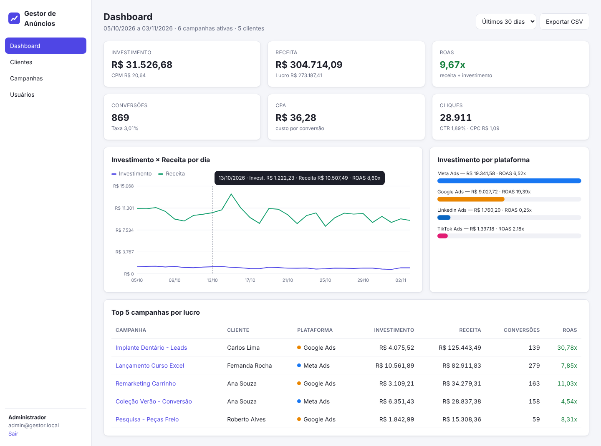

# Gestor de Anúncios

Sistema web **completo e funcional** de gestão de campanhas de tráfego pago (Meta, Google, TikTok e LinkedIn Ads), criado com o **Claude Code** como projeto didático. Roda 100% local, **sem dependências** — só precisa do Node.js.



## Início rápido
Pré-requisito: **Node.js 22.13+**.
```bash
npm start
```
Acesse **http://127.0.0.1:3000** — login `admin@gestor.local` / `admin123` (ou `gestor@gestor.local` / `gestor123`).

| Comando | Descrição |
|---|---|
| `npm start` | inicia o sistema (cria e popula o banco na 1ª vez) |
| `npm run dev` | modo desenvolvimento com recarga automática |
| `npm run seed` | recria o banco com dados de demonstração |
| `npm test` | testes automatizados (19 testes) |

## Funcionalidades
- Login com perfis **admin** e **gestor**
- **Dashboard** com investimento, receita, ROAS, CPA, CTR, CPC, gráficos e top campanhas
- **Clientes** e **campanhas** (CRUD, filtros, ativar/pausar)
- **Métricas diárias** por campanha com KPIs calculados
- **Relatório CSV** para Excel
- Gestão de **usuários**, tema escuro, layout responsivo

## Documentação técnica
| # | Documento |
|---|---|
| 1 | [Visão geral, stack e glossário de KPIs](docs/01-visao-geral.md) |
| 2 | [Arquitetura](docs/02-arquitetura.md) |
| 3 | [Banco de dados](docs/03-banco-de-dados.md) |
| 4 | [Referência da API REST](docs/04-api.md) |
| 5 | [Instalação e execução local](docs/05-instalacao-e-execucao.md) |
| 6 | [Guia do usuário + roteiro de aula](docs/06-guia-do-usuario.md) |
| 7 | [Segurança e testes](docs/07-seguranca-e-testes.md) |
| 8 | [Como foi construído com o Claude Code + exercícios](docs/08-como-foi-construido-com-claude-code.md) |

## Stack
Node.js (`node:http`, `node:sqlite`, `node:crypto`, `node:test`) · HTML/CSS/JavaScript puro · gráficos em SVG.

> Projeto educacional. Veja as limitações de segurança conhecidas em [docs/07](docs/07-seguranca-e-testes.md) antes de qualquer uso real.
