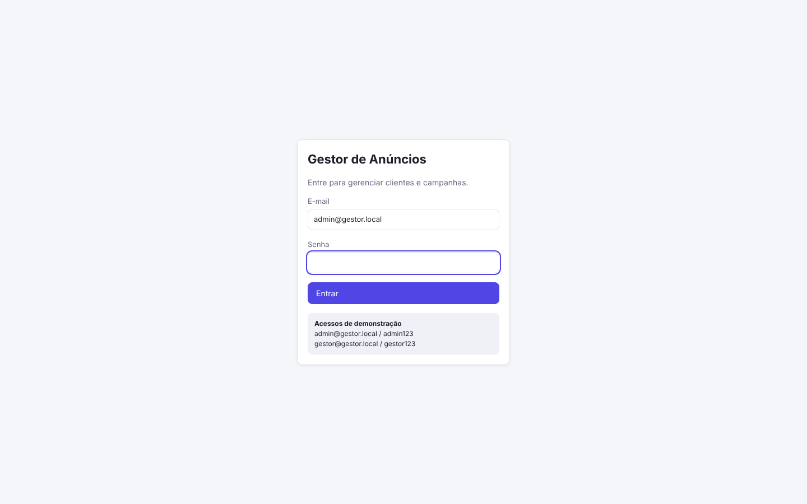
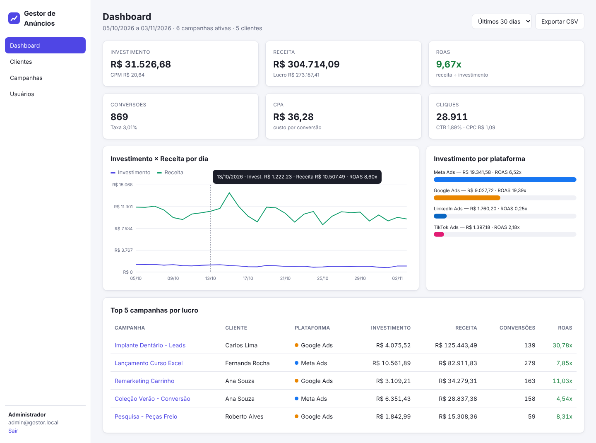
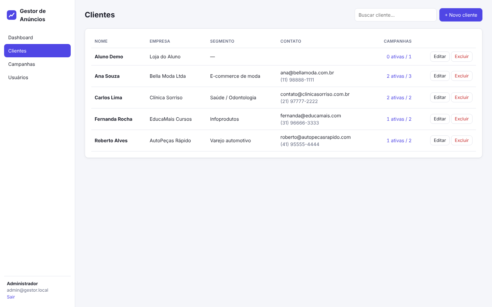
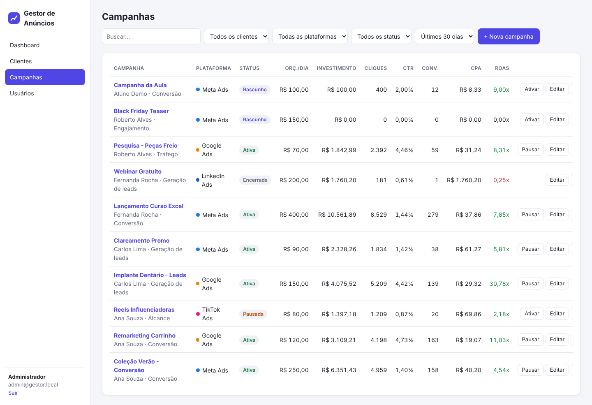
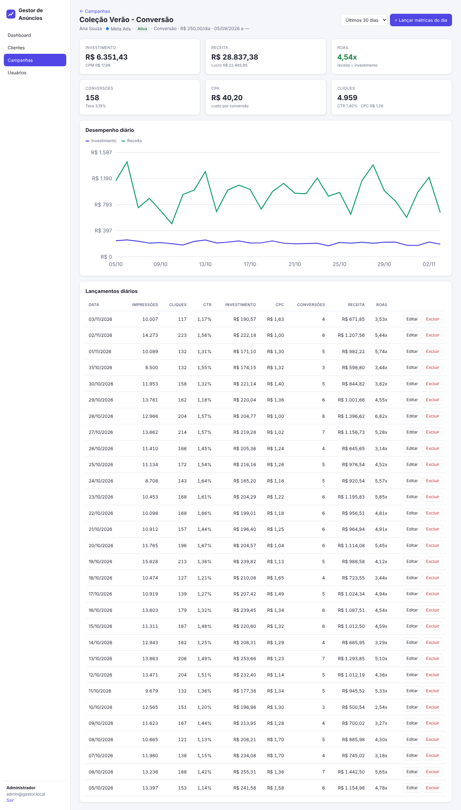
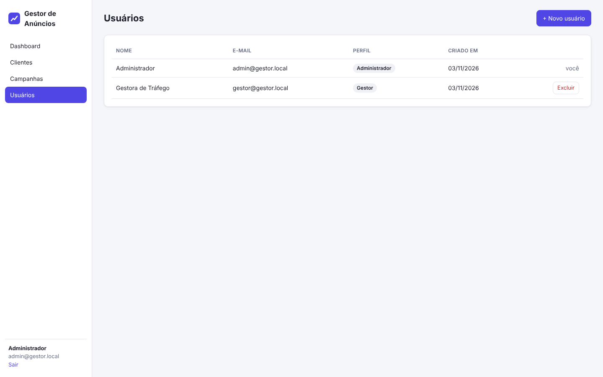
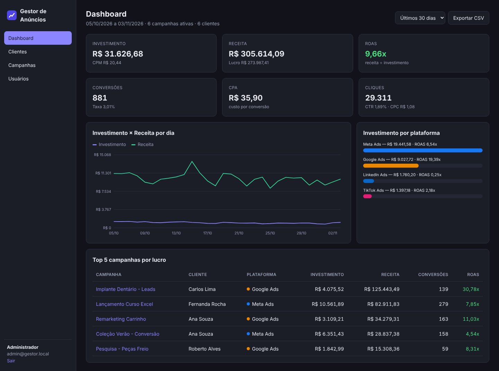

# 6. Guia do Usuário

## Login

## Dashboard
Visão consolidada de todas as campanhas no período escolhido (seletor no topo). Passe o mouse sobre o gráfico para ver os valores do dia. **Exportar CSV** baixa o relatório por campanha.

## Clientes
Busque pelo nome ou empresa, crie com **+ Novo cliente**, edite ou exclua. O link "X ativas / Y" abre as campanhas daquele cliente já filtradas.

## Campanhas
Filtre por cliente, plataforma, status e período. Os botões **Ativar/Pausar** mudam o status na hora. ROAS em verde = campanha lucrativa; em vermelho = prejuízo.

## Detalhe da campanha e lançamento de métricas
Clique no nome da campanha. Use **+ Lançar métricas do dia** para informar os números exportados das plataformas de anúncio. Lançar de novo a mesma data **substitui** os valores.

## Usuários (administrador)

## Tema escuro
Segue automaticamente a preferência do sistema operacional.

## Roteiro de demonstração em aula (≈10 min)
1. `npm start` e mostrar o log no terminal.
2. Login como admin → explicar os KPIs do dashboard.
3. Criar um cliente "Aluno Demo" → tentar salvar vazio para mostrar a validação.
4. Criar uma campanha Meta para ele, ativá-la.
5. Lançar métricas de hoje (ex.: 20.000 impressões, 400 cliques, R$ 100, 12 conversões, R$ 900) → ver ROAS 9x.
6. Voltar ao dashboard e ver o número mudar; exportar CSV e abrir no Excel.
7. Entrar como gestor e mostrar que o menu Usuários some (e a API retorna 403).
8. Abrir o terminal e mostrar as linhas de log de cada requisição.
9. `npm test` para mostrar os testes passando.
