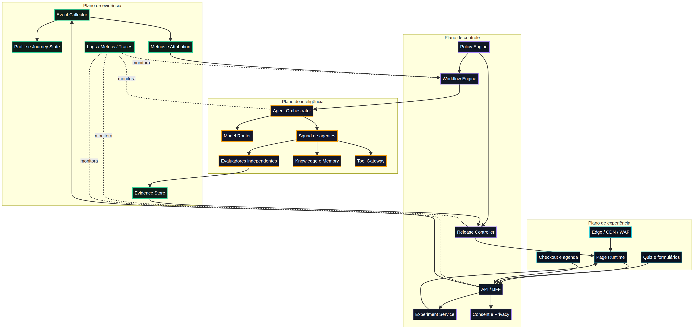

# Vibe Funnel OS — Índice mestre

**Autor:** Manus AI  
**Objetivo:** documentação técnica e estratégica para implementar um squad de agentes auto-otimizáveis, governados e tolerantes a falhas no Claude Code.

## Leitura por perfil

| Perfil | Ordem recomendada |
|---|---|
| Fundador/marketing | 03 → 04 → 05 → páginas 08/09/10 |
| Produto/design | 05 → 08/09/10 → 11 |
| Engenharia/arquitetura | 07 → 13 → `../implementation/ROADMAP.md` |
| Segurança/privacidade | 07 → 13 → research 12 |
| Equipe Claude Code | `CLAUDE.md` → `PROMPT_MESTRE_CLAUDE_CODE.md` → ROADMAP → TASKS |
| Liderança executiva | este índice → 04 → 05 → 07 |

## Documentos normativos

| Arquivo | Conteúdo | Função |
|---|---|---|
| `01_requisitos_extraidos.md` | Requisitos, restrições e aprendizados do material anterior | Base de escopo |
| `03_mapa_mercado_e_dores.md` | Segmentos, dores, sinais e implicações | Estratégia de mercado |
| `04_matriz_selecao_funis.md` | Priorização reproduzível | Decisão dos três funis |
| `05_especificacao_dos_3_funis.md` | Jornada completa, ofertas e métricas | Product/Funnel Spec |
| `06_notas_claude_code.md` | Capacidades oficiais e limites | Fundamentação da execução |
| `07_arquitetura_squad_auto_otimizavel.md` | Arquitetura, agentes, runtime, governança e antifalhas | Architecture Spec |
| `08_pagina_vendas_vibe_rescue.md` | Copy e design completos | Sales Page Spec 1 |
| `09_pagina_vendas_agentops_roi.md` | Copy e design completos | Sales Page Spec 2 |
| `10_pagina_vendas_launch_os.md` | Copy e design completos | Sales Page Spec 3 |
| `11_design_system_copy_personalizacao.md` | Tokens, componentes, voz e Decision API | Experience Spec |
| `13_dados_experimentacao_seguranca_operacoes.md` | Dados, experimentos, SRE, LGPD e threat model | Operational Spec |

Notas intermediárias e dados de pesquisa ficam em `../research/`. Diagramas renderizados e fontes Mermaid ficam em `../assets/`.

## Decisão dos três funis

| Prioridade | Funil | Dor central | Oferta inicial | North Star |
|---:|---|---|---|---|
| 1 | Vibe Rescue | Projeto criado com IA entrou em loops de regressão, contexto perdido e deploy frágil | Diagnóstico + Sprint Rescue | Release reproduzível e aprovado |
| 2 | AgentOps ROI | Organização usa IA sem medir ganho líquido nem controlar risco | Readiness + piloto limitado | Ganho líquido ajustado por qualidade, risco e custo |
| 3 | Launch OS | Iniciante acumula demos, mas não chega a um produto publicável | Diagnóstico + Sprint Launch OS | Release aprovado e primeiro valor observado |

## Arquitetura em uma frase

> Agentes geram propostas e artefatos; serviços determinísticos validam contratos e políticas; avaliadores independentes produzem evidência; o Governor decide; o Release Controller publica por canary e pode reverter.

## Ordem de implementação

A implementação não começa pelas três páginas ao mesmo tempo. Começa por contratos, Mission, policy, evidência e um único vertical slice. Em seguida, o Vibe Rescue valida o runtime público; experimentação e release control entram antes dos outros dois funis; personalização e auto-otimização chegam somente com controle saudável e dados íntegros.

| Marco | Resultado |
|---:|---|
| M0 | Missão criada, persistida, observada e governada |
| M1 | Agente executa em sandbox com tool policy e budget |
| M2 | Vibe Rescue em homologação com assessment e analytics |
| M3 | Experimento real controlado e rollback testado |
| M4 | AgentOps ROI e Launch OS completos |
| M5 | Personalização por módulos pré-aprovados |
| M6 | Otimização em shadow mode |
| M7 | Autonomia limitada por envelope, guardrails e kill switch |

## Arquivos executáveis para Claude Code

| Arquivo/diretório | Uso |
|---|---|
| `/CLAUDE.md` | Constituição operacional do repositório |
| `/PROMPT_MESTRE_CLAUDE_CODE.md` | Prompt de execução da fase atual |
| `/.claude/agents/` | Subagentes especializados com ferramentas limitadas |
| `/.claude/hooks/` | Bloqueios determinísticos e alertas pós-edição |
| `/.claude/settings.json` | Permissões e registro de hooks |
| `/contracts/` | JSON Schemas dos objetos críticos |
| `/docs/implementation/ROADMAP.md` | Sequência de fases e gates |
| `/docs/implementation/TASKS.md` | Backlog com dependências e critérios |
| `/scripts/validate_pack.py` | Validação estrutural do pacote |

## Não negociáveis

Nenhum agente pode inventar claims, preços, garantias, escassez ou prova. Nenhuma variante é publicada sem exposure logging, guardrails, feature flag e rollback. Nenhuma decisão crítica depende somente do julgamento de um modelo. PII e segredos não entram em analytics ou telemetry genérica. Autor, avaliador e aprovador permanecem separados.

## Status da documentação

O pacote documenta a visão completa e fornece o scaffold operacional para o Claude Code. Ele não contém integração real com checkout, CRM, agenda, provedor de modelos ou infraestrutura de produção; esses pontos usam adapters, configuração e aprovação próprias durante a implementação.
