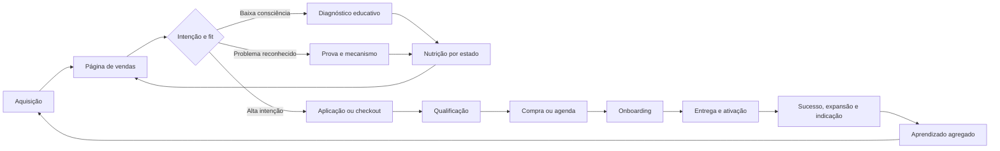

# Especificação estratégica dos três funis prioritários

**Autor:** Manus AI  
**Status:** decisão de produto para detalhamento técnico e criativo  
**Ordem de prioridade:** Vibe Rescue, AgentOps ROI, Launch OS

## Decisão

Os três funis foram escolhidos por intensidade da dor, urgência, poder de compra, diferenciação, força da evidência e adequação à automação. A pontuação é uma ferramenta de decisão, não uma previsão de conversão. O primeiro funil ataca um problema já instalado e emocionalmente urgente; o segundo atende o maior valor econômico; o terceiro amplia a base de aquisição e cria a entrada para a escada de ofertas.

| Prioridade | Funil | Público | Dor nuclear | Oferta central | Papel no portfólio |
|---:|---|---|---|---|---|
| 1 | **Vibe Rescue** | Builder intermediário | Projeto quebradiço, regressões e perda de controle | Diagnóstico e sprint de estabilização | Receita rápida, prova forte e casos de transformação |
| 2 | **AgentOps ROI** | Líder técnico, agência e empresa | Uso de IA sem governança ou prova de ganho líquido | Piloto controlado de governança e observabilidade | Alto ticket, expansão B2B e receita recorrente |
| 3 | **Launch OS** | Iniciante e fundador não técnico | Protótipo sem caminho confiável até o lançamento | Sistema guiado da ideia ao MVP publicável | Volume, comunidade e alimentação dos funis superiores |

## Arquitetura comum aos três funis

Cada funil segue a mesma espinha dorsal de dados, mas muda a mensagem, a oferta, a prova e a ação desejada. A entrada não força o visitante a se identificar como “iniciante” ou “avançado”; o sistema infere intenção por origem, conteúdo consumido e respostas explícitas, sempre oferecendo controle e transparência.

O sistema deve otimizar **valor de longo prazo**, não somente cliques no CTA. A métrica de decisão combina conversão qualificada, receita, ativação, reembolso, churn, satisfação, margem e incidência de suporte. Variantes que aumentam compra e pioram qualidade, cancelamento ou confiança não podem ser promovidas.

---

# Funil 1 — Vibe Rescue

## Página de vendas primeiro

### Promessa central

> **Seu projeto não precisa de mais um prompt. Precisa de um diagnóstico honesto, um plano de resgate e um release que volte a ser previsível.**

A página deve falar com quem já tentou construir, já investiu tempo e está cansado de regressões. A copy não culpa o usuário nem ridiculariza o código. Ela reconhece o esforço, reduz a vergonha e mostra que salvar, refatorar ou reescrever são decisões técnicas diferentes, tomadas após evidência.

### Mecanismo único

O mecanismo é o **Protocolo SAVE**:

| Etapa | Função | Saída verificável |
|---|---|---|
| **S — Scan** | Inventaria arquitetura, dependências, segurança, testes, deploy e comportamento atual | Mapa do sistema e riscos |
| **A — Assess** | Classifica módulos em manter, corrigir, isolar ou substituir | Matriz keep/refactor/rewrite |
| **V — Validate** | Cria testes de caracterização e reproduz falhas antes de alterar | Baseline reproduzível |
| **E — Evolve** | Executa o plano em incrementos, promove somente o que passa nos gates | Release estável, relatório e próximos passos |

### Oferta

A oferta inicial recomendada é uma **avaliação paga de entrada** ou diagnóstico de baixo risco, seguido de uma sprint de estabilização. Isso reduz objeção, protege margem e evita prometer um escopo antes de conhecer o repositório.

| Nível | Entrega | Hipótese de preço para teste | Conversão desejada |
|---|---|---:|---|
| Diagnóstico Rescue | Scanner, relatório, mapa de risco, triagem keep/refactor/rewrite e plano de 14 dias | R$ 497–1.500 | Compra direta |
| Sprint Rescue | Estabilização priorizada, testes, CI, correções críticas e deploy de homologação | R$ 3.000–12.000 | Aplicação + reunião |
| Rescue Care | Monitoramento, manutenção e melhoria governada | R$ 750–3.000/mês | Expansão pós-sprint |

Os valores são hipóteses de posicionamento e devem ser ajustados após capacidade de entrega, tempo real e pesquisa com clientes. O sistema nunca muda preço autonomamente.

### Estrutura da página

| Ordem | Seção | Objetivo psicológico | Elemento obrigatório |
|---:|---|---|---|
| 1 | Hero de reconhecimento | Fazer a pessoa sentir “eles entendem o meu estado” | Headline, subheadline, CTA “Diagnosticar meu projeto” e microcopy de segurança |
| 2 | Sintomas do loop | Nomear o problema sem acusar | Regressões, contexto perdido, medo de deploy e correções intermináveis |
| 3 | Reframe | Explicar por que mais prompts não resolvem | Diagrama do ciclo prompt–patch–regressão |
| 4 | Protocolo SAVE | Dar um mecanismo crível | Quatro etapas e saídas concretas |
| 5 | O que será analisado | Reduzir incerteza | Código, dependências, dados, auth, segredos, testes, CI e infraestrutura |
| 6 | Decisão sem apego | Demonstrar honestidade | Critérios para manter, refatorar ou substituir |
| 7 | Prova | Tornar a transformação tangível | Relatório exemplo, teste antes/depois, release e depoimentos aprovados |
| 8 | Escopo e limites | Evitar expectativa falsa | O que inclui, não inclui e pré-requisitos |
| 9 | Oferta | Facilitar escolha | Diagnóstico, sprint e manutenção |
| 10 | Objeções | Remover risco percebido | “Precisa reescrever?”, “Meu código será exposto?”, “E se não tiver Git?” |
| 11 | CTA final | Converter alta intenção | Aplicação curta ou checkout do diagnóstico |

### Jornada completa

| Estágio | Estado da pessoa | Ativo | CTA | Evento de avanço |
|---|---|---|---|---|
| Topo | Percebe sintomas, mas não conhece a causa | Conteúdo “7 sinais de que seu app entrou no loop de regressão” | Fazer autodiagnóstico | `rescue_assessment_started` |
| Topo | Busca ajuda para bug específico | Scanner/checklist interativo | Ver nível de risco | `rescue_risk_result_viewed` |
| Meio | Aceita que o problema é sistêmico | Relatório exemplo e vídeo de teardown | Solicitar análise do projeto | `rescue_repo_consent_started` |
| Meio | Compara alternativas | Matriz corrigir versus reescrever | Comprar diagnóstico | `rescue_diagnostic_checkout_started` |
| Fundo | Quer resolver agora | Página de oferta e escopo | Pagar diagnóstico ou aplicar para sprint | `rescue_purchase_completed` |
| Pós-venda | Precisa confiar no processo | Onboarding, consentimento de acesso e ambiente de análise | Conectar repositório com escopo mínimo | `rescue_onboarding_completed` |
| Entrega | Avalia valor | Dashboard de achados e plano | Aprovar sprint | `rescue_sprint_approved` |
| Expansão | Quer evitar recaída | Rescue Care | Assinar manutenção | `rescue_care_activated` |

### Qualificação

A qualificação deve usar perguntas com valor explicativo: estágio do produto, ambiente de hospedagem, existência de usuários, pagamentos, dados sensíveis, repositório, frequência de regressão, último deploy estável e urgência. Não pedir acesso ao código antes de consentimento, escopo e política de retenção.

### Objeções e respostas

| Objeção | Resposta de copy | Evidência necessária |
|---|---|---|
| “Vão mandar jogar tudo fora.” | “Reescrever é a última hipótese, não a primeira.” | Matriz de decisão e exemplos anonimizados |
| “Tenho vergonha do código.” | “O projeto será avaliado, não julgado.” | Linguagem respeitosa e política de confidencialidade |
| “Outra IA não vai criar mais problemas?” | “A geração não aprova a própria mudança.” | Separação entre autor, revisor, testes e policy gate |
| “Não posso parar o produto.” | “Trabalhamos com baseline, branch isolada e rollback.” | Fluxo de homologação e plano de recuperação |
| “Não sei explicar o problema.” | “O diagnóstico começa pelos sintomas e pelo comportamento atual.” | Formulário simples e coleta assistida |

### Métrica North Star

**Percentual de projetos que chegam a um release reproduzível, aprovado e sem regressão crítica no período de observação.** A conversão da página é métrica secundária; o funil só é saudável se o cliente realmente volta a entregar.

---

# Funil 2 — AgentOps ROI

## Página de vendas primeiro

### Promessa central

> **Sua equipe já usa IA para escrever código. Agora prove onde ela acelera, bloqueie onde ela aumenta risco e transforme atividade em entrega mensurável.**

A página deve evitar tom de medo puro. O líder avançado não quer uma camada burocrática; ele quer controle sem sacrificar velocidade. A mensagem central é “governança como acelerador”: políticas determinísticas retiram decisões repetitivas da revisão humana e concentram atenção no que realmente é arriscado.

### Mecanismo único

O mecanismo é o **Ciclo CONTROL**:

| Etapa | Função | Saída verificável |
|---|---|---|
| **C — Capture** | Registra uso, contexto, custo, ferramentas e resultado | Telemetria com proveniência |
| **O — Observe** | Mede lead time, retrabalho, falhas, segurança e aceitação | Baseline operacional |
| **N — Normalize** | Compara tarefas e equipes sem confundir atividade com valor | Métricas contextualizadas |
| **T — Test** | Executa piloto e políticas em escopo limitado | Evidência experimental |
| **R — Restrict** | Aplica least privilege, allowlists, budgets e aprovações | Risco contido |
| **O — Optimize** | Promove práticas com ganho líquido e remove desperdício | Playbooks aprovados |
| **L — Learn** | Atualiza política e memória com incidentes e resultados | Evolução auditável |

### Oferta

A oferta recomendada é um piloto de 30 dias em um repositório e um squad, com baseline, instrumentação e gates. O objetivo é mostrar valor antes de uma implantação ampla.

| Nível | Entrega | Hipótese de preço para teste | Conversão desejada |
|---|---|---:|---|
| Readiness Assessment | Mapa de ferramentas, riscos, políticas e baseline | R$ 2.500–7.500 | Reunião executiva |
| Piloto AgentOps ROI | Instrumentação, políticas, dashboards, testes e relatório de ROI | R$ 15.000–60.000 | Aplicação qualificada |
| Plataforma/Managed Governance | Operação, políticas, relatórios e melhoria contínua | R$ 3.000–20.000/mês | Expansão contratual |

Os valores são hipóteses. Contratos, tratamento de dados, integrações e SLA devem ser revisados antes de qualquer oferta definitiva.

### Estrutura da página

| Ordem | Seção | Objetivo | Elemento obrigatório |
|---:|---|---|---|
| 1 | Hero executivo | Articular controle e velocidade | Headline, CTA “Mapear meu baseline” e CTA secundário “Ver arquitetura” |
| 2 | O paradoxo | Mostrar que mais código não equivale a mais entrega | Atividade versus throughput líquido |
| 3 | Riscos invisíveis | Tornar custo de inação concreto | Shadow AI, segredos, dependências, revisão e custo de modelos |
| 4 | Ciclo CONTROL | Explicar o mecanismo | Fluxo visual de captura a aprendizado |
| 5 | Arquitetura | Provar profundidade | Gateway de ferramentas, policy engine, eventos, telemetria e rollback |
| 6 | Piloto de 30 dias | Reduzir risco de compra | Escopo, cronograma, baseline e critérios de saída |
| 7 | Scorecard | Mostrar como ROI será medido | Lead time, retrabalho, defeitos, segurança, custo e satisfação |
| 8 | Segurança e governança | Responder ao comprador técnico | Least privilege, auditoria, retenção e segregação de funções |
| 9 | Prova | Construir confiança | Estudo de caso aprovado, amostra de dashboard e políticas |
| 10 | FAQ de procurement | Remover barreiras | Dados, IP, modelo, integração, SSO, ambientes e saída |
| 11 | Aplicação | Qualificar | Formulário com stack, equipe, volume, riscos e objetivo |

### Jornada completa

| Estágio | Estado da pessoa | Ativo | CTA | Evento de avanço |
|---|---|---|---|---|
| Topo | Desconfia de produtividade ou risco | Benchmark “IA na engenharia: atividade x resultado” | Baixar scorecard | `agentops_scorecard_requested` |
| Topo | Vive incidente ou pressão de auditoria | Checklist de governança | Calcular exposição | `agentops_risk_assessment_completed` |
| Meio | Busca arquitetura e viabilidade | Webinar técnico e referência de policy-as-code | Ver blueprint | `agentops_architecture_viewed` |
| Meio | Avalia fornecedores | Calculadora de piloto e modelo de ROI | Solicitar readiness assessment | `agentops_readiness_requested` |
| Fundo | Tem sponsor e repositório piloto | Página do piloto | Agendar workshop | `agentops_workshop_booked` |
| Qualificação | Confirma fit | Discovery estruturado | Aprovar plano de medição | `agentops_measurement_plan_approved` |
| Entrega | Executa piloto | Dashboard e revisão semanal | Decidir expandir, ajustar ou encerrar | `agentops_pilot_decision_recorded` |
| Expansão | Quer escala | Rollout por squads | Assinar operação contínua | `agentops_rollout_approved` |

### Qualificação

Critérios mínimos: sponsor, equipe com uso real de IA, repositório piloto, pipeline existente, permissão para instrumentar eventos e concordância sobre métricas. O sistema deve recusar o piloto quando o cliente pede vigilância individual invasiva, coleta conteúdo sensível sem base adequada ou uso de métricas para punição sem contexto.

### Objeções e respostas

| Objeção | Resposta de copy | Evidência necessária |
|---|---|---|
| “Governança vai deixar tudo mais lento.” | “Automatize decisões repetitivas e reserve revisão humana para risco real.” | Medição de tempo de gate e taxa de bloqueio útil |
| “Já temos CI e segurança.” | “A camada não substitui seus controles; conecta uso de agentes a eles.” | Diagrama de integração e compatibilidade |
| “Não queremos expor código a outro fornecedor.” | “Telemetria minimizada, implantação configurável e retenção explícita.” | Arquitetura de dados e opções de isolamento |
| “ROI de IA é impossível de medir.” | “Não medimos uma taxa universal; definimos baseline e comparamos no seu fluxo.” | Plano de medição e limitações |
| “A equipe vai rejeitar vigilância.” | “O foco é sistema e processo, não ranking individual.” | Política de uso ético e agregação |

### Métrica North Star

**Ganho líquido de entrega ajustado por qualidade, risco e custo no escopo pilotado.** Nenhuma prática é expandida quando aumenta throughput à custa de incidentes, regressões ou perda de confiança da equipe.

---

# Funil 3 — Launch OS

## Página de vendas primeiro

### Promessa central

> **Pare de colecionar demos. Publique seu primeiro produto com um caminho claro, provas de prontidão e alguém — humano ou agente — sabendo exatamente o próximo passo.**

A página deve reduzir ansiedade sem infantilizar. O iniciante não quer estudar engenharia inteira; quer saber o suficiente para decidir e lançar com responsabilidade. A proposta não é “nunca precisar de especialistas”, mas fazer o sistema assumir a complexidade repetitiva e escalar revisão quando necessário.

### Mecanismo único

O mecanismo é o **Mapa 6D**:

| Etapa | Pergunta | Saída verificável |
|---|---|---|
| **Dor** | Qual problema vale resolver e para quem? | ICP, JTBD e hipótese de valor |
| **Desejo** | Qual transformação a oferta promete? | Proposta, mensagem e critério de sucesso |
| **Design** | Qual menor experiência prova valor? | Fluxo, protótipo e escopo do MVP |
| **Development** | Como construir com contratos e limites? | Aplicação, testes e documentação |
| **Defense** | O que precisa ser protegido e validado? | Segurança, privacidade, qualidade e contingência |
| **Delivery** | Como publicar, medir e aprender? | Deploy, analytics, onboarding e backlog |

### Oferta

A oferta recomendada combina produto educacional e implementação assistida. O aluno trabalha sobre o próprio produto e sai com ativos reais, não apenas aulas concluídas.

| Nível | Entrega | Hipótese de preço para teste | Conversão desejada |
|---|---|---:|---|
| Diagnóstico de lançamento | Score de prontidão e próximo marco | Gratuito ou R$ 27–97 | Lead qualificado |
| Launch OS Sprint | Método, templates, agentes, clínicas e publicação de homologação | R$ 497–1.997 | Checkout direto |
| Launch With Us | Implementação assistida do MVP | R$ 3.000–15.000 | Aplicação |
| Launch Care | Métricas, suporte e iteração mensal | R$ 297–1.500/mês | Expansão |

### Estrutura da página

| Ordem | Seção | Objetivo | Elemento obrigatório |
|---:|---|---|---|
| 1 | Hero aspiracional com limite honesto | Ativar desejo e confiança | Headline, CTA “Descobrir meu próximo passo” e prazo sem promessa absoluta |
| 2 | O cemitério de demos | Nomear a frustração | Protótipos que nunca chegam a usuários |
| 3 | O falso atalho | Reposicionar ferramenta versus sistema | Ferramenta gera partes; sistema coordena decisões |
| 4 | Mapa 6D | Explicar o caminho | Seis etapas, gates e saídas |
| 5 | O que você publica | Tornar resultado concreto | Aplicação, página, onboarding, analytics, documentação e plano de suporte |
| 6 | Para quem é e não é | Qualificar com respeito | Perfil, pré-requisitos e exclusões |
| 7 | Demonstração | Reduzir abstração | Produto exemplo, repositório e checklist de prontidão |
| 8 | Conteúdo e suporte | Mostrar experiência | Módulos, agentes, clínicas, templates e revisão |
| 9 | Prova | Construir segurança | Cases aprovados, evidências e bastidores |
| 10 | Oferta e garantia | Diminuir risco | Plano, preço aprovado e garantia com critérios claros |
| 11 | FAQ | Resolver objeções | Código, tempo, ferramenta, propriedade, suporte e segurança |
| 12 | CTA final | Converter | Entrar na sprint ou aplicar para implementação |

### Jornada completa

| Estágio | Estado da pessoa | Ativo | CTA | Evento de avanço |
|---|---|---|---|---|
| Topo | Tem ideia, mas não sabe por onde começar | Quiz “Qual é o próximo marco do seu app?” | Obter roteiro | `launch_quiz_completed` |
| Topo | Já criou uma demo | Checklist “demo ou produto?” | Calcular prontidão | `launch_readiness_scored` |
| Meio | Quer aprender o método | Aula “do prompt ao release” | Ver o Mapa 6D | `launch_masterclass_watched` |
| Meio | Compara cursos e ferramentas | Página de prova e currículo por resultados | Entrar na sprint | `launch_checkout_started` |
| Fundo | Está pronto para executar | Oferta e plano semanal | Comprar ou aplicar | `launch_purchase_completed` |
| Onboarding | Precisa reduzir incerteza | Wizard de ideia, stack e objetivo | Definir marco de 30 dias | `launch_milestone_defined` |
| Ativação | Executa o primeiro ciclo | Workspace, templates e agentes | Publicar homologação | `launch_staging_deployed` |
| Valor | Chega a usuários | Checklist de release e analytics | Publicar release aprovado | `launch_release_approved` |
| Expansão | Precisa crescer ou estabilizar | Vibe Rescue ou Launch Care | Fazer upgrade | `launch_expansion_started` |

### Qualificação

O quiz deve avaliar clareza do problema, disponibilidade semanal, existência de protótipo, uso de pagamentos, dados sensíveis, prazo e expectativa. Pessoas que querem publicar produto regulado ou de alto risco sem revisão especializada devem ser direcionadas a avaliação humana, não ao checkout automático.

### Objeções e respostas

| Objeção | Resposta de copy | Evidência necessária |
|---|---|---|
| “Eu não sei programar.” | “Você não precisa dominar toda a stack; precisa enxergar decisões, riscos e próximo passo.” | Fluxo guiado e exemplos de explicação |
| “Já comprei cursos e não terminei.” | “O progresso é medido por entregas do seu produto, não por horas assistidas.” | Marcos e artefatos de cada etapa |
| “Qual ferramenta vocês usam?” | “A ferramenta é substituível; o sistema preserva especificação, testes e decisões.” | Matriz de ferramentas e abstração |
| “Vou conseguir colocar no ar?” | “Publicação depende do escopo e dos gates; mostramos exatamente o que falta.” | Checklist e critérios de bloqueio |
| “A IA fica dona do meu código?” | “O repositório e os ativos ficam sob sua titularidade conforme os termos.” | Termos claros e exportação |

### Métrica North Star

**Percentual de participantes que chegam a um release aprovado e obtêm o primeiro sinal de valor de usuário dentro da janela definida.** Conclusão de aulas, quantidade de prompts e volume de código são métricas de atividade, não de sucesso.

---

# Integração entre os funis

Os funis não devem competir entre si. O roteamento deve reconhecer quando a dor declarada não corresponde à oferta visitada e sugerir um caminho melhor sem interromper a experiência.

| Origem | Sinal | Destino recomendado | Regra |
|---|---|---|---|
| Launch OS | Já tem repositório grande e regressões frequentes | Vibe Rescue | Sugerir migração após mostrar o motivo |
| Launch OS | Produto sensível ou time corporativo | AgentOps ROI ou avaliação humana | Bloquear autopublicação de alto risco |
| Vibe Rescue | Projeto ainda é apenas uma ideia | Launch OS | Evitar vender diagnóstico de código inexistente |
| Vibe Rescue | Equipe possui vários repositórios e dezenas de usuários internos de IA | AgentOps ROI | Direcionar para governança sistêmica |
| AgentOps ROI | Pessoa sem sponsor ou equipe | Conteúdo/Launch OS | Não forçar reunião enterprise |
| AgentOps ROI | Incidente isolado em um único projeto | Vibe Rescue | Resolver urgência antes de programa amplo |

## Política de próxima melhor ação

A próxima melhor ação deve ser escolhida por utilidade esperada, e não por maior ticket. O cálculo considera fit, intenção, urgência, risco, esforço solicitado, histórico recente e probabilidade de sucesso pós-compra. Um guardrail impede que o sistema mostre CTA de alta pressão a pessoas com baixo fit, em crise emocional ou em contexto sensível.

## KPIs compartilhados

| Camada | Métrica | Interpretação |
|---|---|---|
| Aquisição | Custo por visitante qualificado | Eficiência sem premiar tráfego irrelevante |
| Mensagem | Taxa de compreensão da oferta | Se a pessoa entende para quem é e o que recebe |
| Conversão | Conversão qualificada | Compra ou aplicação que atende critérios de fit |
| Receita | Receita líquida e margem por coorte | Resultado econômico após reembolso, suporte e entrega |
| Ativação | Primeiro marco de valor | Evidência de que o cliente começou a transformação |
| Resultado | North Star específica do funil | Sucesso real, não apenas compra |
| Confiança | Reclamações, reversões e consentimento | Guardrail reputacional e ético |
| Aprendizado | Hipóteses invalidadas e tempo até decisão | Capacidade de aprender sem churn de variantes |

## Ordem de implementação

A construção deve começar pela página do **Vibe Rescue**, porque a dor é urgente, o mecanismo é diferenciável e a prova pode ser gerada com projetos piloto. Em seguida vem **AgentOps ROI**, reutilizando observabilidade, políticas e relatórios. O **Launch OS** fecha a primeira onda, reaproveitando o motor de jornada e convertendo uma audiência maior em uma experiência guiada.

| Onda | Entrega | Razão |
|---:|---|---|
| 1 | Vibe Rescue: página, diagnóstico e funil mínimo | Valida dor, copy, operação e geração de prova |
| 2 | AgentOps ROI: página e piloto instrumentado | Monetiza arquitetura e controles em ticket maior |
| 3 | Launch OS: página, quiz e sprint | Escala aquisição e cria comunidade |
| 4 | Motor de personalização entre funis | Só depois de baseline e volume suficiente |
| 5 | Auto-otimização governada | Promove variações apenas após dados, guardrails e aprovação |
