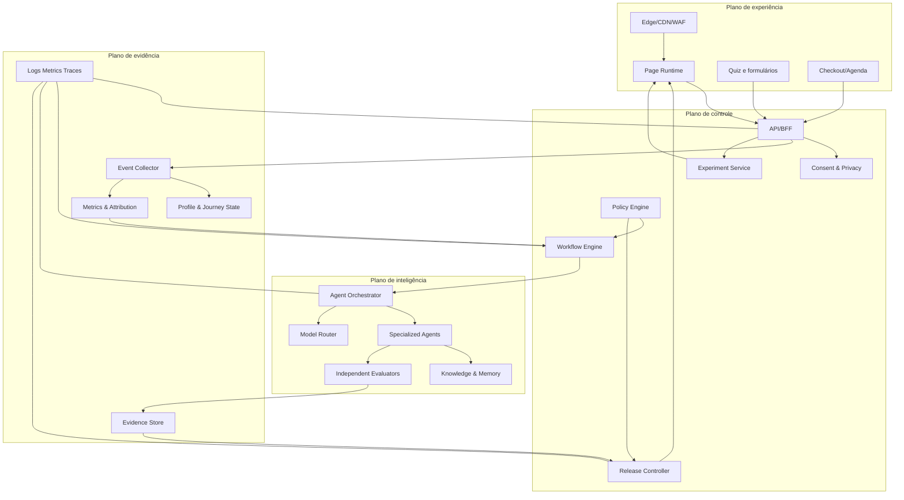
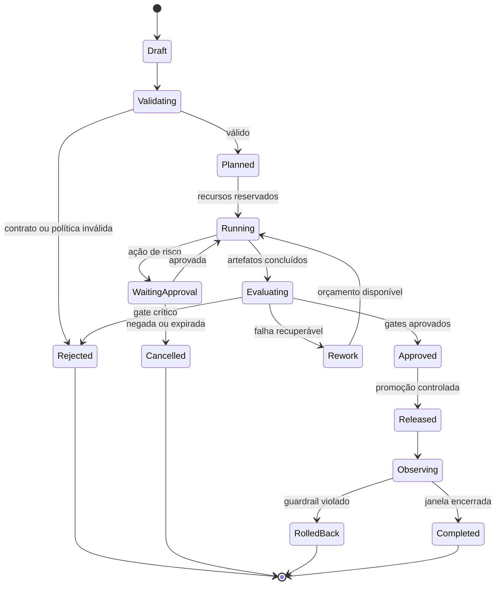
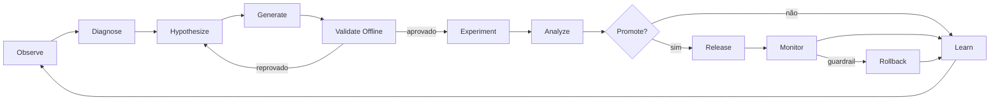

# Arquitetura enterprise do squad auto-otimizável de funis

**Autor:** Manus AI  
**Versão:** 1.0  
**Status:** especificação de referência para implementação no Claude Code  
**Escopo:** três funis de vibe coding, páginas adaptativas, experimentação governada e operação contínua

## 1. Objetivo arquitetural

O sistema deve criar, publicar, medir e melhorar funis sem permitir que um modelo probabilístico altere diretamente produção. A autonomia será **progressiva, limitada e reversível**. Agentes propõem e executam trabalho em ambientes isolados; serviços determinísticos validam contratos, políticas e métricas; pessoas aprovam decisões de alto risco; a plataforma registra todas as etapas.

> **Regra fundamental:** nenhuma variante chega a produção por parecer melhor. Ela precisa ser admissível, testável, aprovada conforme o risco, observada e reversível.

A arquitetura separa claramente **plano de experiência**, responsável por páginas e jornada do visitante; **plano de inteligência**, responsável por hipóteses, conteúdo e decisões; **plano de controle**, responsável por política, estado e auditoria; e **plano de evidência**, responsável por dados, métricas, testes e atribuição.

## 2. Requisitos de qualidade

| Atributo | Requisito | Verificação |
|---|---|---|
| Segurança | Least privilege, isolamento de ferramentas, proteção de segredos e aprovação proporcional ao risco | Policy tests, secrets scan, SAST, DAST e auditoria |
| Confiabilidade | Idempotência, retries limitados, dead-letter queue, compensação e rollback | Chaos tests e testes de falha parcial |
| Auditabilidade | Toda decisão liga hipótese, dados, modelo, prompt, ferramenta, política, aprovação e resultado | Trace end-to-end e evidence bundle |
| Reversibilidade | Toda publicação tem versão anterior válida e procedimento automático de restauração | Teste de rollback em homologação |
| Explicabilidade | A decisão precisa gerar reason codes e evidências; raciocínio privado do modelo não é requisito | Decision record estruturado |
| Privacidade | Minimização, consentimento, finalidade, retenção e exclusão | Data inventory e testes de DSAR |
| Acessibilidade | WCAG como requisito de release, não melhoria posterior | axe, teclado, contraste e revisão manual |
| Portabilidade | Domínio, contratos e dados não dependem de um único provedor de modelo | Adapters e contract tests |
| Eficiência | Model routing, cache, budgets e avaliação seletiva | Custo por decisão e por resultado |
| Ética comercial | Sem prova inventada, urgência falsa, discriminação ou dark patterns | Claim registry e review gate |

## 3. Arquitetura lógica



### 3.1 Plano de experiência

O runtime da página entrega conteúdo versionado, resolve variantes server-side quando possível e preserva uma experiência estável mesmo quando serviços de inteligência estão indisponíveis. O visitante nunca aguarda um agente gerar conteúdo em tempo real para carregar a página principal. Personalização online usa apenas variantes pré-aprovadas e regras de baixa latência.

| Componente | Responsabilidade | Falha segura |
|---|---|---|
| Edge/CDN/WAF | TLS, cache, rate limiting, proteção e roteamento | Servir última versão saudável |
| Page Runtime | Renderização SSR/edge, SEO, acessibilidade e composição | Variante controle |
| Form/Quiz Runtime | Coleta progressiva, validação e consentimento | Salvar rascunho ou oferecer contato alternativo |
| Checkout/Agenda Adapter | Encaminhar compra ou agenda a provedor | Não duplicar cobrança; exibir estado pendente |
| Personalization Resolver | Selecionar experiência elegível | Controle global quando contexto for insuficiente |

### 3.2 Plano de controle

O plano de controle é a fonte de verdade operacional. Ele mantém estados, políticas, aprovações e versões. Modelos podem recomendar uma decisão, mas não substituir a máquina de estados.

| Componente | Responsabilidade | Propriedade crítica |
|---|---|---|
| Workflow Engine | Executar jornadas e missões duráveis | Exactly-once lógico via idempotência |
| Policy Engine | Avaliar ações, dados, claims, risco e permissões | Decisão determinística e versionada |
| Experiment Service | Registrar hipótese, alocação, exposição e decisão | Imutabilidade do protocolo após início |
| Release Controller | Promover, pausar e reverter variantes | Atomicidade e canary |
| Consent & Privacy | Finalidade, consentimento, retenção e direitos | Negação por padrão para uso não autorizado |
| Approval Service | Revisão humana e segregação de funções | Autor não aprova a própria alteração |

### 3.3 Plano de inteligência

O plano de inteligência produz alternativas, análises e explicações. Ele opera em tarefas com input/output estruturados. Nenhum agente escreve livremente em bancos de produção; ferramentas são adapters com escopo mínimo.

| Componente | Responsabilidade | Controle |
|---|---|---|
| Agent Orchestrator | Decompor missão, delegar, acompanhar e sintetizar | DAG, timeout, budget e cancelamento |
| Model Router | Escolher modelo por risco, custo e capacidade | Catálogo versionado e fallback |
| Knowledge Service | Recuperar marca, oferta, evidências e políticas | Proveniência, validade e ACL |
| Memory Service | Registrar aprendizados aprovados | TTL, deduplicação e direito de exclusão |
| Evaluator Pool | Avaliar copy, UX, risco, factualidade e código | Independência do gerador |
| Tool Gateway | Intermediar acesso a repositório, analytics e CMS | Allowlists, schema e audit log |

### 3.4 Plano de evidência

O plano de evidência impede que a otimização seja guiada por impressões. Ele separa eventos observados, métricas derivadas, hipóteses e decisões.

| Componente | Responsabilidade | Controle |
|---|---|---|
| Event Collector | Ingerir eventos web e operacionais | Schema registry e deduplicação |
| Profile/Journey State | Manter estado autorizado do relacionamento | Minimização e expiração |
| Metrics Service | Calcular conversão, qualidade e guardrails | Definições versionadas |
| Attribution Service | Relacionar origem, exposição e resultado | Janelas e limitações explícitas |
| Evidence Store | Armazenar relatórios, screenshots, testes e aprovações | Content hash e retenção |
| Observability | Logs, métricas e traces técnicos | Correlação por trace e mission ID |

## 4. Arquitetura de execução

A unidade fundamental de trabalho é a **Mission**. Uma missão tem objetivo, escopo, artefatos esperados, políticas, orçamento, deadline, owner e critérios de conclusão. A execução é um DAG persistente de Steps; cada Step produz Artifact e Evidence; decisões geram DecisionRecord.



### 4.1 Semântica de estado

| Estado | Condição de entrada | Saída permitida |
|---|---|---|
| Draft | Missão criada | Editar ou enviar para validação |
| Validating | Contrato congelado para análise | Rejeitar ou planejar |
| Planned | DAG, budgets e políticas aprovados | Iniciar |
| Running | Steps ativos | Esperar aprovação, avaliar, cancelar |
| WaitingApproval | Gate exige pessoa ou função independente | Aprovar, negar ou expirar |
| Evaluating | Artefatos prontos para gates | Rework, rejeitar ou aprovar |
| Approved | Evidence bundle completo | Release |
| Released | Versão publicada | Observar ou reverter |
| Observing | Janela ativa de monitoramento | Concluir ou rollback |
| Completed | Objetivo e janela concluídos | Somente leitura |

## 5. Squad de agentes

O squad é organizado em quatro células: **Estratégia**, **Experiência**, **Evidência** e **Governança/Entrega**. Um agente é uma função operacional com contrato e ferramentas, não uma persona decorativa.

### 5.1 Célula de estratégia

| Agente | Missão | Ferramentas | Não pode fazer | Saída |
|---|---|---|---|---|
| Market Intelligence | Atualizar dores, linguagem e sinais de mercado | Pesquisa, knowledge base | Publicar claims | `market_insight_set` |
| ICP & Journey Strategist | Manter segmentos, estados e jobs | Dados agregados, CRM autorizado | Usar atributos sensíveis | `journey_model` |
| Offer Architect | Formular oferta, mecanismo, escopo e objeções | Catálogo, provas, pricing aprovado | Alterar preço ou garantia | `offer_spec` |
| Funnel Strategist | Projetar etapas, handoffs e ações | Jornada, conteúdo e métricas | Publicar | `funnel_spec` |
| Hypothesis Planner | Criar hipótese falsificável e prioridade | Baselines, backlog, heurísticas | Iniciar experimento | `experiment_proposal` |

### 5.2 Célula de experiência

| Agente | Missão | Ferramentas | Não pode fazer | Saída |
|---|---|---|---|---|
| Human Copywriter | Criar copy coerente, humana e específica | Brand voice, offer spec, proof registry | Inventar prova ou urgência | `copy_bundle` |
| UX Architect | Definir hierarquia, fluxo, componentes e acessibilidade | Design tokens, analytics agregados | Alterar política de dados | `ux_spec` |
| Visual Designer | Produzir direção visual e assets | Design system, media library | Usar marcas sem licença | `visual_bundle` |
| Personalization Designer | Mapear módulos adaptativos e regras | Journey state, eligibility rules | Personalizar por atributo proibido | `experience_matrix` |
| Lifecycle Writer | Escrever e-mail, WhatsApp autorizado e onboarding | Consent state, templates | Enviar mensagem sem opt-in | `lifecycle_sequence` |

### 5.3 Célula de evidência

| Agente | Missão | Ferramentas | Não pode fazer | Saída |
|---|---|---|---|---|
| Analytics Engineer | Definir eventos, métricas e qualidade | Schema registry, warehouse | Mudar meta para favorecer variante | `measurement_plan` |
| Experiment Analyst | Desenhar e analisar testes | Exposure log, metrics | Editar variante ou hipótese em curso | `experiment_analysis` |
| Evidence Curator | Validar fonte, expiração e permissão de provas | Proof registry | Criar depoimento | `evidence_manifest` |
| Content Evaluator | Avaliar clareza, coerência e claims | Rubricas, copy bundle | Reescrever e aprovar simultaneamente | `content_evaluation` |
| Journey QA | Testar fluxo, tracking e estados | Browser test, synthetic data | Promover release | `journey_test_report` |

### 5.4 Célula de governança e entrega

| Agente | Missão | Ferramentas | Não pode fazer | Saída |
|---|---|---|---|---|
| Policy Guardian | Explicar violações de políticas determinísticas | Policy API, audit log | Conceder exceção final | `policy_explanation` |
| Security Reviewer | Analisar threat model, segredos e dependências | SAST, SCA, DAST, repo read | Fazer deploy | `security_report` |
| Privacy Reviewer | Avaliar consentimento, minimização e retenção | Data inventory, DPIA templates | Alterar base legal | `privacy_report` |
| Release Engineer | Empacotar e executar canary/rollback | CI/CD, feature flags | Aprovar a própria build | `release_manifest` |
| Incident Commander | Conter falha, pausar experimentos e coordenar recuperação | Kill switch, observability | Ocultar impacto | `incident_record` |
| Learning Curator | Converter resultados em conhecimento reutilizável | Evidence store, memory | Promover aprendizado não validado | `learning_candidate` |
| Governor | Agregar gates e emitir decisão final de máquina | Policy results, approvals, evidence | Alterar evidência | `governance_decision` |

## 6. Segregação de funções

A separação mínima é **autor → avaliador → governador → publicador**. Em mudanças de baixo risco, avaliação e governo podem ser automatizados por serviços distintos; em mudanças de alto risco, pessoas diferentes devem executar aprovação e publicação.

| Artefato | Autor | Avaliador | Aprovação | Publicação |
|---|---|---|---|---|
| Copy de seção | Human Copywriter | Content Evaluator | Automática se risco baixo | Release Engineer |
| Claim de resultado | Human Copywriter | Evidence Curator | Humana obrigatória | Release Engineer |
| Preço ou garantia | Offer Architect propõe | Financeiro/legal | Humana obrigatória | Release Engineer |
| Segmentação | Personalization Designer | Privacy Reviewer | Governor + humano conforme risco | Decision Service |
| Código | Implementation Agent | Code/Security Reviewer + CI | Branch protection | Release Engineer |
| Resultado de experimento | Experiment Analyst | Statistical checker | Governor | Experiment Service |
| Política | Policy owner humano | Security/Privacy | Change board | Policy deploy pipeline |

## 7. Níveis de autonomia

| Nível | Capacidade | Exemplos | Gate |
|---:|---|---|---|
| L0 | Observar | Resumir dados e detectar anomalia | Somente leitura |
| L1 | Recomendar | Sugerir hipótese, copy ou ação | Humano executa |
| L2 | Preparar | Criar variante, testes e release candidate | Aprovação antes de publicar |
| L3 | Executar reversível | Iniciar experimento de baixo risco pré-aprovado | Budget, canary e rollback |
| L4 | Otimizar dentro de envelope | Redistribuir tráfego entre variantes aprovadas | Limites, guardrails e auditoria |
| L5 | Não permitido no baseline | Alterar livremente oferta, preço, política ou produção | Proibido |

A autonomia é atribuída a uma **capacidade específica**, não ao sistema inteiro. Um agente pode operar em L3 para trocar ordem de módulos aprovados e permanecer em L1 para claims, preço ou checkout.

## 8. Loop de auto-otimização

O loop possui oito fases e dois caminhos independentes: **offline**, no qual agentes criam e avaliam candidatos; e **online**, no qual o sistema testa somente candidatos aprovados.



### 8.1 Regra de hipótese

Toda hipótese precisa declarar população, intervenção, controle, métrica primária, guardrails, mudança mínima relevante, janela, critério de parada e risco. A formulação padrão é:

> Para **[segmento elegível]**, alterar **[elemento]** de **[controle]** para **[variante]** aumentará **[métrica primária]** em pelo menos **[efeito mínimo]**, sem ultrapassar **[guardrails]**, porque **[mecanismo causal]**.

### 8.2 Promoção

Uma variante só pode ser promovida quando satisfizer simultaneamente validade técnica, política, acessibilidade, privacidade, qualidade editorial, integridade de dados e regra estatística. O resultado gera `PromotionDecision` com status `PROMOTE`, `KEEP_CONTROL`, `CONTINUE`, `PAUSE` ou `INVALID`.

## 9. Contratos centrais

### 9.1 Mission

```json
{
  "mission_id": "mis_01J...",
  "tenant_id": "ten_01J...",
  "type": "CREATE_SALES_PAGE_VARIANT",
  "goal": "Aumentar aplicação qualificada do Vibe Rescue",
  "scope": {"funnel_id": "vibe-rescue", "page_id": "sales-main"},
  "inputs": [{"artifact_id": "offer_v3", "sha256": "..."}],
  "required_outputs": ["copy_bundle", "ux_spec", "evaluation_bundle"],
  "risk_class": "MEDIUM",
  "autonomy_level": "L2",
  "budgets": {"max_cost_usd": 20, "max_duration_seconds": 1800, "max_turns": 40},
  "policies": ["claims-v2", "privacy-br-v1", "brand-v4"],
  "success_criteria": ["all_required_artifacts", "all_blocking_gates_pass"],
  "created_by": "user_123",
  "created_at": "2026-08-25T18:00:00Z"
}
```

### 9.2 Artifact

```json
{
  "artifact_id": "art_01J...",
  "mission_id": "mis_01J...",
  "type": "copy_bundle",
  "schema_version": "1.0.0",
  "content_uri": "s3://evidence/...",
  "content_hash": "sha256:...",
  "generator": {"agent": "human-copywriter", "model": "provider/model", "prompt_version": "copy-v7"},
  "sources": ["offer_v3", "proof_registry_v2"],
  "classification": "INTERNAL",
  "created_at": "2026-08-25T18:05:00Z"
}
```

### 9.3 GovernanceDecision

```json
{
  "decision_id": "gov_01J...",
  "subject_type": "release_candidate",
  "subject_id": "rel_01J...",
  "policy_version": "bundle-2026-08-25",
  "risk_class": "MEDIUM",
  "decision": "REQUIRE_APPROVAL",
  "reason_codes": ["NEW_CLAIM", "CHECKOUT_ADJACENT_CHANGE"],
  "blocking_failures": [],
  "required_approvals": ["marketing_owner"],
  "evidence_ids": ["ev_content", "ev_a11y", "ev_tracking"],
  "expires_at": "2026-08-27T18:00:00Z"
}
```

### 9.4 ExperimentSpec

```json
{
  "experiment_id": "exp_01J...",
  "hypothesis_id": "hyp_01J...",
  "unit": "anonymous_or_known_visitor_id",
  "population": "eligible_vibe_rescue_visitors",
  "variants": [{"id": "control", "weight": 0.5}, {"id": "b", "weight": 0.5}],
  "primary_metric": "qualified_application_rate",
  "guardrails": ["refund_rate", "complaint_rate", "page_error_rate", "lead_quality_score"],
  "minimum_detectable_effect": 0.1,
  "analysis_method": "preconfigured",
  "start_rule": "manual_after_approval",
  "stop_rules": ["max_sample", "max_duration", "safety_guardrail"],
  "immutable_after_start": true
}
```

## 10. Política de risco

| Classe | Exemplos | Aprovação | Release |
|---|---|---|---|
| Baixa | Espaçamento, ordem de prova aprovada, microcopy sem claim | Automática | Canary 10% |
| Média | Headline, CTA, formulário, novo módulo, e-mail de nutrição | Owner de marketing ou regra pré-aprovada | Experimento limitado |
| Alta | Preço, garantia, checkout, coleta de dados, tracking novo, depoimento | Humana dupla conforme domínio | Janela controlada |
| Crítica | Auth, pagamento, dados sensíveis, base legal, domínio, infraestrutura | Change board e revisão especializada | Rollout manual com rollback testado |
| Proibida | Prova inventada, urgência falsa, atributos sensíveis para persuasão, bypass de consentimento | Nunca | Bloqueada |

## 11. Padrões antifalhas

| Falha | Detecção | Contenção | Recuperação | Aprendizado |
|---|---|---|---|---|
| Modelo produz JSON inválido | Schema validation | Rejeitar artifact | Retry com repair prompt e limite | Registrar modelo/prompt |
| Agente entra em loop | Max turns, tempo e repetição | Cancelar step | Replanejar uma vez | Assinatura do loop |
| Dois agentes editam mesmo arquivo | Lock e worktree | Bloquear merge | Rebase ou ownership | Atualizar task graph |
| Evento duplicado | Idempotency key | Deduplicar | Reprocessar janela | Métrica de duplicação |
| Métrica muda durante teste | Metric version pin | Invalidar análise | Reiniciar experimento | Alertar data contract |
| Variante derruba página | Synthetic check e error budget | Feature flag off | Rollback automático | Postmortem |
| Claim sem prova | Claim registry | Bloquear release | Solicitar fonte ou remover | Adicionar regra |
| Segredo em código | Pre-commit e CI scan | Revogar acesso à publicação | Remover e rotacionar | Atualizar scanner e treinamento |
| Webhook repetido ou fora de ordem | Event ID e sequence | Idempotência | Replay controlado | Monitorar produtor |
| Provedor de modelo indisponível | Circuit breaker | Fallback ou fila | Retry com jitter | Atualizar roteamento |
| Custo excede budget | Meter em tempo real | Interromper missão | Aprovação de aumento | Ajustar modelo/contexto |
| Guardrail comercial piora | Monitoramento sequencial | Pausar variante | Voltar ao controle | Registrar efeito adverso |

## 12. Observabilidade

Todo fluxo deve propagar `trace_id`, `tenant_id`, `mission_id`, `agent_run_id`, `experiment_id`, `variant_id` e `release_id` quando aplicável. Logs nunca devem conter prompt completo, PII ou segredos por padrão; payloads sensíveis são referenciados por hash e armazenados em cofre com ACL.

| Sinal | Exemplos | Uso |
|---|---|---|
| Métricas técnicas | Latência, erro, fila, timeout, tokens, custo | SLO e capacity planning |
| Métricas de agentes | Sucesso de schema, retries, aprovação, rework | Qualidade e roteamento |
| Métricas de funil | Exposição, avanço, qualificação, compra, ativação | Decisão de produto |
| Guardrails | Reclamação, reembolso, churn, acessibilidade, erro | Proteção contra otimização nociva |
| Traces | Missão → agente → ferramenta → artifact → gate → release | Auditoria e diagnóstico |
| Evidence | Relatórios, screenshots, scans, aprovações e hashes | Reprodutibilidade |

### SLOs iniciais

| SLO | Meta inicial | Error budget |
|---|---:|---:|
| Disponibilidade das páginas | 99,9% mensal | 43,8 min/mês |
| p75 LCP em mobile | ≤ 2,5 s | 5% das pageviews elegíveis |
| Ingestão de eventos válida | ≥ 99,5% | 0,5% |
| Decisão de variante online p95 | ≤ 75 ms | 1% |
| Execuções sem estado órfão | ≥ 99,9% | 0,1% |
| Rollback após alerta crítico | ≤ 5 min | Sem tolerância repetida |
| Artefatos com proveniência completa | 100% | Bloqueio de release |

## 13. Memória e aprendizado

Memória não é um arquivo cumulativo sem governança. O sistema mantém quatro tipos: conhecimento estável, evidência temporal, memória operacional e candidato a aprendizado. Somente o Learning Curator e o Governor podem promover um candidato a regra reutilizável.

| Tipo | Exemplo | TTL | Promoção |
|---|---|---|---|
| Conhecimento de marca | Voz, termos proibidos, design tokens | Até nova versão | Aprovação de owner |
| Evidência | Pesquisa, depoimento, resultado de teste | Data de validade definida | Evidence Curator |
| Memória operacional | Falha de webhook, timeout de modelo | 30–180 dias | Automática para diagnóstico |
| Aprendizado causal | “Headline B venceu para segmento X” | Limitado ao contexto | Governor após análise |
| Regra global | “Nunca usar urgência sem prova” | Permanente até revisão | Policy owner |

Aprendizados devem registrar escopo. Uma conclusão válida para tráfego de campanha, em um período e oferta específicos não vira automaticamente regra universal.

## 14. Personalização segura

A personalização usa **estado da jornada e intenção explícita**, não inferências invasivas. Os atributos aceitos incluem página de entrada, conteúdo consumido, etapa declarada, problema selecionado, tamanho da equipe informado e status de cliente. Atributos sensíveis, proxies discriminatórios e inferência psicológica profunda são proibidos.

| Categoria | Exemplo | Uso |
|---|---|---|
| Contextual | UTM, dispositivo, idioma, página | Layout e continuidade |
| Comportamental de primeira parte | Conteúdo visto, quiz, retorno | Próxima melhor ação |
| Declarado | Nível, objetivo, estágio, equipe | Oferta e explicação |
| Relacional | Lead, cliente, onboarding | Continuidade |
| Proibido | Saúde, religião, etnia, orientação, vulnerabilidade financeira inferida | Nunca para persuasão |

## 15. Integração com Claude Code

A documentação oficial permite subagentes de projeto com contextos, ferramentas, permissões e memória independentes, além de isolamento por worktree.[1] Hooks podem executar controles em eventos como `PreToolUse`, `PostToolUse`, falha e solicitação de permissão.[2] A execução programática pode usar `claude -p` ou Agent SDK; o modo `--bare` é recomendado para scripts por evitar configuração implícita.[3] Equipes de agentes existem, mas são experimentais e apresentam limitações de retomada, coordenação e shutdown, portanto não serão a fonte de verdade do runtime de produção.[4]

A integração seguirá estas regras:

| Regra | Implementação |
|---|---|
| Configuração explícita | `.claude/agents/`, `.claude/settings.json`, schemas e prompts versionados |
| Isolamento | Worktree por agente mutador e branch por missão |
| Menor privilégio | `tools`/`disallowedTools`, allowlists e permission modes |
| Gates determinísticos | Hooks chamando scripts locais ou Policy API |
| CI reproduzível | `--bare`, agentes explícitos, output JSON e exit code |
| Estado persistente | Banco/workflow externo; sessão Claude nunca é fonte única |
| Segredos | Cofre/variáveis do runner; nunca em prompt, arquivo ou log |
| Saída | JSON Schema estrito e artifact manifest |

## 16. Alternativas de implantação

A arquitetura lógica é a mesma; muda a infraestrutura. A escolha depende de escala, equipe, requisitos de isolamento e orçamento. Nenhuma opção elimina a necessidade de política, auditoria e testes.

| Abordagem | Como funciona | Trade-offs | Custo relativo | Complexidade de setup |
|---|---|---|---|---|
| **Aplicação gerenciada modular** | Frontend, API, banco, storage e jobs em plataforma gerenciada; agentes chamados por serviços server-side | Lançamento rápido e menos operação; menor controle de runtime e portabilidade | Baixo no início | Baixa a média |
| **Contêineres em nuvem com serviços gerenciados** | Web/API/workers em containers; PostgreSQL, Redis/queue, object storage e observabilidade gerenciados | Bom equilíbrio entre controle e operação; exige DevOps | Médio | Média a alta |
| **Kubernetes cloud-agnostic** | Serviços independentes, workflow engine, policy engine e observabilidade em cluster | Máximo controle e escala; custo e complexidade altos antes de product-market fit | Alto | Muito alta |
| **Execução local/piloto** | Docker Compose e Claude Code no computador do time; produção limitada ou inexistente | Barato e útil para validar; não atende alta disponibilidade | Baixo | Média |

A alternativa leve é a aplicação gerenciada modular. A alternativa de maior controle é a implantação em containers. Kubernetes só deve ser escolhido quando volume, isolamento, requisitos regulatórios ou múltiplos times justificarem o custo.

## 17. Estratégia de evolução

| Estágio | Arquitetura | Capacidade liberada |
|---|---|---|
| 0 — Simulação | Dados sintéticos, páginas locais e policy engine | Validar contratos e fluxos |
| 1 — Shadow | Agentes observam e recomendam sem publicar | Medir qualidade offline |
| 2 — Homologação | Agentes preparam variantes e releases | Validar squad e rollback |
| 3 — Produção assistida | Humano aprova toda mudança | Gerar baseline de confiança |
| 4 — Autonomia limitada | L3 em mudanças de baixo risco | Aumentar velocidade com envelope |
| 5 — Otimização online | L4 em alocação entre variantes aprovadas | Aprender continuamente com guardrails |

## 18. Definition of Done da arquitetura

A arquitetura estará implementada quando uma missão puder ser criada por API, validada por schema e política, decomposta em Steps, executada em worktree isolada, gerar artifacts com hashes, passar por avaliadores independentes, exigir aprovação conforme risco, publicar em homologação, receber eventos sintéticos, decidir uma promoção, executar canary e rollback, e produzir uma trilha completa que permita reproduzir a decisão.

## Referências

[1]: https://code.claude.com/docs/en/sub-agents "Claude Code Docs — Create custom subagents"
[2]: https://code.claude.com/docs/en/hooks "Claude Code Docs — Hooks reference"
[3]: https://code.claude.com/docs/en/headless "Claude Code Docs — Run Claude Code programmatically"
[4]: https://code.claude.com/docs/en/agent-teams "Claude Code Docs — Orchestrate teams of Claude Code sessions"
