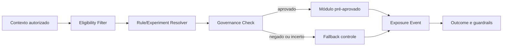

# Design system, copy humanizada e personalização governada

**Autor:** Manus AI  
**Escopo:** Vibe Rescue, AgentOps ROI e Launch OS  
**Objetivo:** garantir consistência, diferenciação visual, alta clareza e adaptação sem dark patterns

## 1. Princípio de experiência

As páginas pertencem à mesma marca, mas não devem parecer cópias com cores diferentes. Cada uma representa um estado emocional específico: **recuperação** no Vibe Rescue, **controle** no AgentOps ROI e **progressão** no Launch OS. O design system compartilha fundações, componentes, acessibilidade e governança; a direção de arte muda por funil.

| Funil | Emoção inicial | Emoção desejada | Metáfora visual | Movimento |
|---|---|---|---|---|
| Vibe Rescue | Ansiedade e frustração | Alívio e controle | Sistema saindo de falha para estabilidade | Status e recuperação |
| AgentOps ROI | Pressão e incerteza executiva | Confiança e visão | Cockpit de decisão | Fluxo, policy e evidência |
| Launch OS | Entusiasmo disperso | Clareza e avanço | Mapa com marcos | Progressão por etapa |

## 2. Fundações compartilhadas

### Tipografia

A stack deve usar fontes variáveis e fallback seguro. Display e corpo podem vir da mesma família para reduzir custo; mono é reservado para IDs, métricas e trechos de configuração.

| Token | Desktop | Mobile | Uso |
|---|---:|---:|---|
| `display-xl` | clamp(56px, 6vw, 84px) / 0.98 | clamp(42px, 12vw, 60px) | Hero curto |
| `display-lg` | clamp(44px, 5vw, 68px) / 1.02 | 38–50px | Hero longo |
| `heading-1` | 48px / 1.08 | 36px / 1.12 | Títulos principais |
| `heading-2` | 36px / 1.15 | 30px / 1.18 | Seções |
| `heading-3` | 24px / 1.25 | 22px / 1.28 | Cards |
| `body-lg` | 20px / 1.6 | 18px / 1.6 | Introduções |
| `body-md` | 16px / 1.65 | 16px / 1.6 | Corpo |
| `label` | 13px / 1.2, uppercase | 12px | Eyebrows e status |

Headlines devem usar entre 7 e 16 palavras na primeira dobra. Parágrafos acima de três linhas em desktop precisam ser limitados a 65–75 caracteres por linha.

### Espaçamento

| Token | Valor |
|---|---:|
| `space-1` | 4 px |
| `space-2` | 8 px |
| `space-3` | 12 px |
| `space-4` | 16 px |
| `space-5` | 24 px |
| `space-6` | 32 px |
| `space-7` | 48 px |
| `space-8` | 64 px |
| `space-9` | 96 px |
| `space-10` | 128 px |

Seções usam 96–160 px em desktop e 64–96 px em mobile. Elementos interativos possuem alvo mínimo de 44×44 px.

### Elevação, borda e raio

| Token | Uso |
|---|---|
| `radius-sm: 8px` | Inputs e tags |
| `radius-md: 14px` | Botões e cards compactos |
| `radius-lg: 20px` | Painéis principais |
| `radius-xl: 28px` | Hero panels e oferta |
| `border-subtle` | Separação estrutural |
| `shadow-focus` | Foco de CTA e modal, não decoração constante |

### Motion

Transições usam 120–240 ms para feedback e até 400 ms para mudança de layout. Entrada por scroll é opcional e nunca condição para ler conteúdo. `prefers-reduced-motion` remove parallax, contadores animados e deslocamentos.

## 3. Componentes

| Componente | Variantes | Estados obrigatórios | Regra de conversão |
|---|---|---|---|
| Button | primary, secondary, tertiary, destructive | default, hover, focus, disabled, loading | Um CTA primário por viewport |
| Offer Card | standard, recommended, enterprise | available, waitlist, unavailable | “Recomendado” exige regra real |
| Proof Card | case, testimonial, evidence | verified, expired, pending | Conteúdo pending não renderiza |
| Risk Callout | info, warning, critical | open, acknowledged | Não usar warning para urgência comercial |
| Progress Map | horizontal, vertical | current, complete, blocked, future | Estado deriva de evidência |
| Metric Tile | value, delta, context | demo, live, unavailable | Demo claramente rotulada |
| FAQ | single, grouped | collapsed, expanded | Funciona por teclado |
| Assessment | short, progressive | idle, valid, invalid, saving, complete | Explica finalidade e saída |
| Consent | analytics, marketing, repository | granted, denied, withdrawn | Negação não pode quebrar conteúdo essencial |
| Sticky CTA | compact | visible, hidden | Some quando CTA ou formulário está visível |

## 4. Regras de copy humanizada

Copy humanizada não significa simular amizade ou usar informalidade excessiva. Significa reconhecer contexto, usar linguagem concreta, explicar limites e preservar a agência da pessoa.

### Voz

| Princípio | Aplicação | Exemplo |
|---|---|---|
| Reconhecer antes de ensinar | Nomear esforço e estado | “Você já construiu mais do que parece.” |
| Especificar sem humilhar | Descrever sintoma, não rotular pessoa | “O baseline se perdeu”, não “você fez tudo errado” |
| Ambição com mecanismo | Toda promessa mostra como | “Mapear, validar e evoluir”, não “resultado garantido” |
| Transparência de limite | Dizer o que não está incluído | “O diagnóstico prioriza; a sprint executa.” |
| Linguagem de decisão | Mostrar escolha e próximo passo | “Manter, refatorar, isolar ou substituir.” |
| Respeito por maturidade | Não infantilizar iniciantes nem vender hype a especialistas | Profundidade progressiva |

### Padrões proibidos

| Padrão | Motivo | Alternativa |
|---|---|---|
| Urgência falsa | Manipulação | Disponibilidade real e data verificável |
| “Zero bugs”, “100% seguro” | Impossível sustentar | Critérios, cobertura e limites |
| Prova social inventada | Fraude reputacional | Placeholder fail-closed |
| Contador que reinicia | Dark pattern | Janela real ou nenhum contador |
| Vergonha e culpa | Reduz confiança | Reconhecimento e reframe |
| Headline universal | Ignora contexto | Público, dor e transformação específicos |
| Jargão sem tradução | Exclui | Explicação em camadas |
| Falsa personalização | Efeito “sabemos tudo sobre você” | Usar apenas dados declarados e contexto recente |

### Checklist editorial

Toda seção precisa responder a pelo menos uma pergunta: **isso é para mim?**, **vocês entendem o meu problema?**, **por que acontece?**, **como funciona?**, **o que recebo?**, **por que acreditar?**, **qual o risco?** ou **o que faço agora?**. Se uma seção não responde nenhuma delas, deve ser removida ou reescrita.

## 5. Personalização governada

O runtime não gera uma página inteira por visitante. Ele compõe experiências a partir de módulos pré-aprovados. Cada módulo tem `eligibility`, `content_version`, `risk_class`, `proof_dependencies` e fallback.



### Hierarquia de sinais

| Prioridade | Sinal | Exemplo | Confiabilidade |
|---:|---|---|---|
| 1 | Declarado no fluxo | “Já tenho um repositório” | Alta |
| 2 | Estado relacional | Lead, cliente, onboarding | Alta, sujeito a consentimento |
| 3 | Comportamento recente first-party | Quiz ou conteúdo visto | Média |
| 4 | Contexto de aquisição | UTM, campanha, página | Média |
| 5 | Dispositivo/idioma | Mobile, pt-BR | Alta para layout, baixa para intenção |
| Proibido | Inferência sensível | Saúde, religião, etnia, vulnerabilidade | Não utilizar |

### Módulos adaptáveis

| Módulo | Pode adaptar | Não pode adaptar automaticamente |
|---|---|---|
| Hero | Dor, mecanismo e CTA aprovados | Claim quantitativo, preço e garantia |
| Sintomas | Ordem e relevância | Criar diagnóstico sem dados |
| Prova | Caso compatível e autorizado | Inventar ou alterar resultado |
| FAQ | Ordem por dúvida provável | Ocultar limitações |
| CTA | Próxima ação adequada | Pressão, escassez ou preço |
| Formulário | Campos por estágio | Coleta sensível desnecessária |
| Oferta | Plano elegível | Desconto, preço, termo contratual |
| Visual | Densidade e tema por contexto | Alterar identidade sem aprovação |

### Decision API

Input mínimo:

```json
{
  "tenant_id": "ten_...",
  "funnel_id": "vibe-rescue",
  "page_id": "sales-main",
  "visitor_id": "pseudonymous-id",
  "consent": {"analytics": true, "personalization": true},
  "context": {
    "entry_source": "regression-content",
    "journey_state": "problem-aware",
    "declared_stage": "existing-repository",
    "device_class": "mobile"
  }
}
```

Output mínimo:

```json
{
  "decision_id": "dec_...",
  "experience_id": "vr-problem-aware-v3",
  "modules": {
    "hero": "vr-hero-regression-v2",
    "cta_primary": "vr-cta-assessment-v1",
    "proof": "vr-proof-control-v1"
  },
  "experiment": {"id": "exp_...", "variant": "b"},
  "reason_codes": ["DECLARED_EXISTING_REPO", "ENTRY_REGRESSION_CONTENT"],
  "fallback": false,
  "expires_at": "2026-08-25T19:05:00Z"
}
```

A resposta não contém texto gerado em tempo real. Ela seleciona IDs de conteúdo versionado.

## 6. Máquina de estado da jornada

| Estado | Evidência mínima | Próxima ação padrão | Saída |
|---|---|---|---|
| `unaware` | Entrada ampla | Conteúdo de problema | Nenhuma oferta agressiva |
| `problem_aware` | Consumo ou sintoma declarado | Diagnóstico | Score explicável |
| `solution_aware` | Mecanismo visualizado | Prova e comparação | Ação de avaliação |
| `offer_aware` | Oferta visitada | Escopo, preço e risco | Checkout/aplicação |
| `high_intent` | Checkout, agenda ou retorno frequente | Remover fricção | Conversão |
| `customer` | Compra verificada | Onboarding | Ativação |
| `at_risk` | Falha, inatividade ou reclamação | Suporte e contenção | Recuperação |
| `advocate` | Resultado + consentimento | Indicação ou case | Prova autorizada |

Estados não avançam por mero scroll. Eles exigem evento e evidência. O visitante pode regredir ou optar por resetar personalização.

## 7. Estratégia de testes de página

A ordem de teste evita mudar tudo ao mesmo tempo. Primeiro valida compreensão e fit; depois mecanismo e prova; somente então microinterações.

| Onda | Hipótese | Elementos | Métrica primária | Guardrails |
|---:|---|---|---|---|
| 1 | O visitante reconhece a dor correta | Hero e sintomas | Compreensão/avanço qualificado | Bounce, reclamação |
| 2 | O mecanismo aumenta confiança | SAVE/CONTROL/6D | Assessment ou application rate | Lead quality |
| 3 | Prova reduz risco | Cases e evidence sample | Conversion qualified | Refund, support |
| 4 | Oferta está clara | Escopo e planos | Checkout/application completion | Misfit rate |
| 5 | CTA e formulário reduzem fricção | Microcopy e campos | Completion rate | Data quality |
| 6 | Personalização ajuda | Módulos pré-aprovados | Incremental qualified conversion | Fairness e complaints |

## 8. Acessibilidade

As páginas devem tratar acessibilidade como gate. Headings seguem ordem sem saltos; componentes funcionam por teclado; foco é visível; inputs têm labels e mensagens ligadas por `aria-describedby`; cores não carregam significado sozinhas; vídeos possuem legenda; gráficos têm resumo textual; tabelas grandes possuem alternativa móvel legível.

| Teste | Automático | Manual |
|---|---|---|
| Contraste e landmarks | axe/Lighthouse | Revisão visual |
| Teclado e foco | Parcial | Navegação ponta a ponta |
| Screen reader | Semiautomático | NVDA/VoiceOver em fluxos críticos |
| Zoom e reflow | CSS tests | 200% e 400% |
| Motion | Media query test | Experiência com redução ativa |
| Formulários | Schema e DOM | Erro, retorno e recuperação |

## 9. Performance

| Budget | Meta inicial |
|---|---:|
| JavaScript inicial gzip | ≤ 180 KB por página pública |
| CSS crítico gzip | ≤ 40 KB |
| Imagem hero mobile | ≤ 180 KB, AVIF/WebP com fallback |
| Fonts | ≤ 2 famílias e subconjuntos necessários |
| Requests third-party antes de consentimento | 0 não essenciais |
| Layout shift | CLS ≤ 0,1 |
| LCP p75 mobile | ≤ 2,5 s |
| INP p75 | ≤ 200 ms |

Personalização deve ser resolvida no servidor/edge quando possível, sem flash de conteúdo incorreto. Se o Decision Service falhar ou ultrapassar timeout, o controle é servido imediatamente.

## 10. Content registry

Cada bloco de copy é um objeto versionado:

```json
{
  "content_id": "vr-hero-regression-v2",
  "funnel_id": "vibe-rescue",
  "module": "hero",
  "locale": "pt-BR",
  "risk_class": "MEDIUM",
  "status": "APPROVED",
  "headline": "Cada correção cria outra? Pare o ciclo antes do próximo deploy.",
  "body": "...",
  "cta_id": "vr-cta-assessment-v1",
  "claim_ids": [],
  "proof_dependencies": [],
  "approved_by": "marketing_owner",
  "approved_at": "2026-08-25T18:00:00Z",
  "expires_at": null,
  "content_hash": "sha256:..."
}
```

Conteúdo `DRAFT`, `PENDING`, `REJECTED`, `EXPIRED` ou sem dependência de prova válida não é elegível para produção.

## 11. Definition of Done

O pacote de experiência está pronto quando os três funis possuem tokens, componentes, copy completa, metadados, estados responsivos, eventos, placeholders comerciais fail-closed, módulos de personalização, regras de fallback, testes de acessibilidade, budgets de performance e aprovação editorial. A auto-otimização só inicia após baseline de controle e volume mínimo definido no plano experimental.
