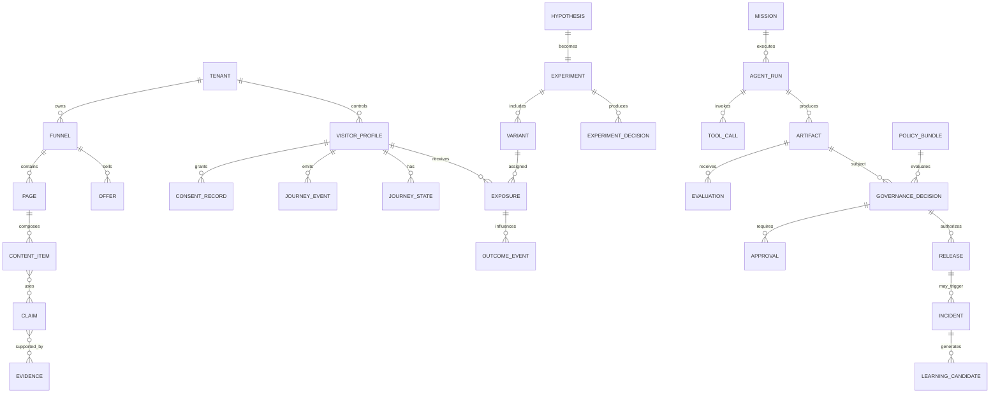
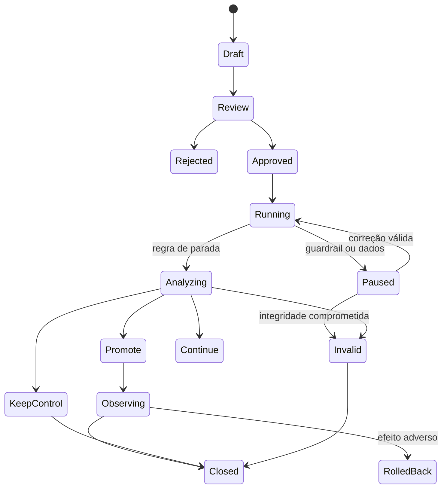

# Dados, experimentação, segurança, privacidade e operações

**Autor:** Manus AI  
**Versão:** 1.0  
**Status:** especificação de produção  
**Aviso:** controles jurídicos e contratuais devem ser validados por profissionais responsáveis antes do lançamento

## 1. Objetivo

Este documento define como o sistema coleta sinais, mede resultado, executa experimentos, protege dados e opera sob falhas. O desenho evita dois erros comuns: otimizar conversão sem qualidade e tratar “auto-otimização” como autorização para alterar produção sem controle.

A função objetivo é multiobjetivo e limitada por guardrails. O sistema busca aumentar conversão qualificada e resultado do cliente, mas nunca pode aceitar piora material em reembolso, reclamação, segurança, privacidade, acessibilidade, estabilidade ou margem.

## 2. Princípios de dados

| Princípio | Regra operacional |
|---|---|
| Finalidade | Todo evento possui finalidade e owner definidos |
| Necessidade | Propriedades não essenciais não entram no schema |
| Proveniência | Métrica aponta para eventos, versão e transformação |
| Imutabilidade | Exposure e transações comerciais não são sobrescritas |
| Idempotência | Todo evento externo possui key deduplicável |
| Qualidade | Schema, cardinalidade, atraso e completude são monitorados |
| Separação | PII transacional fica fora do analytics genérico |
| Expiração | Dados e features possuem TTL ou justificativa explícita |
| Reprodutibilidade | Decisões mantêm versão de métrica, conteúdo e política |
| Contestabilidade | Decisões relevantes geram reason codes e canal de revisão |

## 3. Modelo de domínios



## 4. Entidades centrais

| Entidade | Chave | Dados principais | Retenção padrão |
|---|---|---|---|
| Tenant | `tenant_id` | plano, região, políticas, chaves de configuração | Contrato + prazo legal |
| VisitorProfile | `visitor_id` pseudônimo | estado de jornada e preferências permitidas | 13 meses ou política aprovada |
| ConsentRecord | `consent_id` | finalidade, estado, versão, origem e timestamp | Prova enquanto necessário |
| JourneyEvent | `event_id` | tipo, tempo, contexto mínimo e schema version | 13–25 meses, configurável |
| ContentItem | `content_id` | módulo, locale, risco, status e hash | Histórico de versões |
| Claim | `claim_id` | texto, tipo, escopo e expiração | Enquanto publicado + auditoria |
| Evidence | `evidence_id` | fonte, licença, validade, hash e autorização | Conforme contrato/fonte |
| Hypothesis | `hypothesis_id` | população, mecanismo, métricas e guardrails | Histórico experimental |
| Experiment | `experiment_id` | protocolo imutável, alocação e janela | Histórico experimental |
| Exposure | `exposure_id` | unidade, variante, tempo e decisão | Histórico de análise |
| Mission | `mission_id` | objetivo, risco, budgets e estado | Auditoria operacional |
| AgentRun | `agent_run_id` | modelo, prompt version, custo e status | 90–365 dias |
| GovernanceDecision | `decision_id` | política, resultado, razões e evidências | Auditoria e contrato |
| Release | `release_id` | versão, flags, canary, rollback e owner | Histórico de release |
| Incident | `incident_id` | severidade, impacto, timeline e ações | Política de segurança |

Os prazos são defaults de produto, não determinação jurídica. Cada tenant poderá ter política específica respeitando minimização e obrigações aplicáveis.

## 5. Envelope de evento

```json
{
  "event_id": "evt_01J...",
  "event_name": "vr_assessment_completed",
  "schema_version": "1.0.0",
  "occurred_at": "2026-08-25T18:00:00.000Z",
  "received_at": "2026-08-25T18:00:00.412Z",
  "tenant_id": "ten_01J...",
  "anonymous_id": "anon_pseudonymous",
  "user_id": null,
  "session_id": "ses_01J...",
  "funnel_id": "vibe-rescue",
  "page_id": "sales-main",
  "page_version": "3.2.0",
  "decision_id": "dec_01J...",
  "experiment_id": "exp_01J...",
  "variant_id": "b",
  "consent_state": {"analytics": true, "personalization": true, "marketing": false},
  "properties": {
    "risk_band": "high",
    "recommended_path": "diagnostic"
  },
  "context": {
    "locale": "pt-BR",
    "device_class": "mobile",
    "source_group": "organic"
  },
  "idempotency_key": "sha256:..."
}
```

### Regras de schema

1. `event_name`, `schema_version`, `occurred_at`, `tenant_id`, `session_id` e `idempotency_key` são obrigatórios.
2. Eventos rejeitados vão para quarantine topic, não são descartados silenciosamente.
3. Mudança breaking exige nova major version; consumers suportam janela de migração.
4. Texto livre é proibido no analytics, salvo campo explicitamente classificado e redigido.
5. PII não pode entrar em `properties` ou `context`.
6. `experiment_id` e `variant_id` são gravados no momento da exposição, não inferidos posteriormente.
7. Compra, agenda e reembolso são confirmados por evento server-side assinado.

## 6. Catálogo mínimo de eventos

| Domínio | Evento | Fonte de verdade | Deduplicação |
|---|---|---|---|
| Web | `page_viewed` | Page runtime | session + page + view token |
| Decisão | `experience_resolved` | Decision Service | decision_id |
| Exposição | `variant_exposed` | Page runtime server-side | unit + experiment + allocation epoch |
| Conteúdo | `module_engaged` | Cliente | event_id |
| Lead | `assessment_started/completed` | Form service | assessment_id + state |
| Comercial | `checkout_started` | Commerce adapter | checkout_id |
| Comercial | `purchase_completed/refunded` | Webhook verificado | provider_event_id |
| Agenda | `meeting_booked/cancelled` | Scheduling adapter | provider_event_id |
| Ativação | `milestone_reached` | Product service | customer + milestone version |
| Agente | `agent_run_started/completed/failed` | Orchestrator | agent_run_id + attempt |
| Ferramenta | `tool_call_requested/allowed/blocked/result` | Tool Gateway | tool_call_id |
| Governança | `decision_emitted` | Policy/Governor | decision_id |
| Release | `release_started/promoted/rolled_back` | Release Controller | release_id + stage |
| Incidente | `incident_opened/mitigated/closed` | Incident service | incident_id + transition |

## 7. Métricas

### 7.1 Camadas

| Camada | Pergunta | Métricas |
|---|---|---|
| Aquisição | O tráfego certo chega? | visitantes qualificados, custo por visitante qualificado |
| Compreensão | A oferta é entendida? | comprehension score, CTA pertinente, scroll qualificado |
| Conversão | Pessoas com fit avançam? | assessment, aplicação e compra qualificadas |
| Economia | O funil gera valor sustentável? | receita líquida, margem, CAC, payback e custo de suporte |
| Ativação | O cliente percebe valor? | milestone, tempo até valor e conclusão de onboarding |
| Resultado | A transformação acontece? | North Star de cada funil |
| Confiança | A otimização respeita limites? | reclamação, opt-out, reembolso e reversão |
| Operação | O sistema executa com qualidade? | SLO, falha, rollback, custo e rework de agente |

### 7.2 Definições

**Taxa de conversão qualificada**

```text
qualified_conversion_rate = qualified_conversions / eligible_unique_visitors
```

Uma conversão é qualificada apenas quando satisfaz critérios de fit versionados. Alterar o score de fit exige nova versão e não reclassifica retroativamente um experimento iniciado.

**Receita líquida por visitante elegível**

```text
net_revenue_per_eligible_visitor =
  (gross_revenue - refunds - taxes - payment_fees - variable_delivery_cost) /
  eligible_unique_visitors
```

**Ganho líquido de engenharia**

```text
net_delivery_gain =
  normalized_delivery_output
  - rework_cost
  - defect_cost
  - review_overhead
  - model_and_infra_cost
  - incident_cost
```

Essa métrica exige modelo acordado com o cliente e não deve ser comparada entre organizações sem normalização.

### 7.3 North Stars

| Funil | North Star | Guardrails obrigatórios |
|---|---|---|
| Vibe Rescue | Projetos que chegam a release reproduzível e aprovado | regressão crítica, incidentes, suporte e satisfação |
| AgentOps ROI | Ganho líquido ajustado por qualidade, risco e custo | confiança da equipe, segurança e latência de gate |
| Launch OS | Participantes que chegam a release aprovado e primeiro valor | reembolso, abandono, risco e suporte |

## 8. Qualidade de dados

| Checagem | Regra | Ação em falha |
|---|---|---|
| Schema | ≥99,5% eventos válidos | Quarentena e alerta |
| Duplicação | ≤0,5% por produtor | Corrigir producer/idempotency |
| Atraso | p95 abaixo do SLO | Marcar janela incompleta |
| Completude | Campos críticos ≥99% | Invalidar métrica afetada |
| Cardinalidade | Dentro do budget | Bloquear dimensão explosiva |
| Sample Ratio Mismatch | Distribuição compatível com alocação | Pausar análise e investigar |
| Cross-tenant | 0 eventos com tenant inconsistente | Incidente de segurança |
| PII scan | 0 achados em analytics | Bloquear pipeline e remover |
| Reconciliação financeira | 100% de eventos finais conciliados | Receita não usada até correção |

## 9. Experimentação

### 9.1 Princípios

O experimento deve ser planejado antes da primeira exposição. A hipótese, métrica primária, guardrails, população, unidade de randomização, efeito mínimo, janela, método e parada ficam imutáveis. Alterações exigem encerrar como `INVALID` e iniciar novo experimento.

| Regra | Motivo |
|---|---|
| Uma métrica primária | Evitar escolher o resultado mais conveniente |
| Guardrails pré-definidos | Impedir ganho local nocivo |
| Unidade estável | Evitar o visitante ver variantes conflitantes |
| Exposure logging | Analisar apenas quem realmente recebeu a variante |
| Controle persistente | Preservar baseline |
| Peeking controlado | Evitar parar quando o gráfico “parece bom” |
| Sanity checks | Detectar tracking e alocação quebrados |
| Segmentos pré-especificados | Evitar mineração pós-hoc |
| Janela de resultado | Ligar compra a ativação, reembolso e churn |
| Decisão registrada | Explicar promoção, continuação ou invalidação |

### 9.2 Ciclo



### 9.3 Método baseline

O MVP usa teste randomizado com horizonte e critérios pré-definidos. O sistema não ativa bandits para pages de alto impacto antes de haver telemetria madura, simulador e regras de segurança. A análise pode ser frequentista ou bayesiana, desde que o método esteja congelado no `ExperimentSpec` e testado em dados sintéticos de engenharia, não usado para inventar performance de negócio.

| Decisão | Condição mínima |
|---|---|
| `PROMOTE` | Métrica primária atende regra, guardrails passam, dados íntegros, policy aprova |
| `KEEP_CONTROL` | Variante não atende efeito mínimo ou apresenta piora |
| `CONTINUE` | Regra permite e budget/janela continuam válidos |
| `PAUSE` | Guardrail, SRM, tracking ou incidente |
| `INVALID` | Protocolo quebrado, exposição contaminada ou dados não recuperáveis |

### 9.4 Otimização multiobjetivo

O sistema calcula uma utilidade somente entre opções elegíveis:

```text
utility =
  w1 * qualified_conversion_lift
+ w2 * net_revenue_lift
+ w3 * activation_lift
- w4 * refund_lift
- w5 * complaint_lift
- w6 * support_cost_lift
```

Os pesos são aprovados por humanos e versionados. Guardrails são restrições duras; não podem ser “compensados” por conversão maior. Uma variante com reclamação ou risco acima do limite é inelegível, mesmo que sua utilidade agregada pareça positiva.

## 10. Claim Registry

Toda afirmação material da página é tratada como dado governado.

| Campo | Exemplo |
|---|---|
| `claim_id` | `claim_replit_84_adoption` |
| `text` | Texto exato aprovado |
| `type` | factual, testimonial, case, comparison, guarantee |
| `scope` | página, país, período, oferta |
| `source_uri` | URL ou evidence ID |
| `permission` | licença/consentimento |
| `approved_by` | responsável |
| `valid_from/to` | janela |
| `risk_class` | low/medium/high |
| `status` | draft/approved/expired/rejected |

O renderizador falha fechado quando um módulo depende de claim ausente, expirado ou não aprovado. O fallback remove o bloco ou usa copy sem alegação material.

## 11. Observabilidade de agentes

O OpenTelemetry padroniza atributos como modelo solicitado, tokens de entrada/saída e motivos de finalização; conteúdo completo pode ser registrado por opt-in, mas deve ser tratado como sensível.[1]

### 11.1 Spans

| Span | Atributos |
|---|---|
| `mission.execute` | mission_id, type, risk, budget, status |
| `agent.run` | agent_type, model, prompt_version, attempt, cost |
| `gen_ai.chat` | `gen_ai.request.model`, tokens, finish reasons |
| `tool.call` | tool_name, policy_decision, duration, result_status |
| `artifact.create` | artifact_type, schema, hash |
| `evaluation.run` | rubric_version, evaluator, verdict |
| `governance.decide` | policy_bundle, risk, decision, reason_codes |
| `release.promote` | release_id, stage, flag, approval |
| `experiment.assign` | experiment, unit, variant, allocation_epoch |

Prompt, response e tool payload integral não entram no backend padrão. Quando debugging exige conteúdo, o evento armazena referência criptografada, redigida, com acesso e TTL.

### 11.2 Métricas operacionais

| Métrica | Tipo | Alerta |
|---|---|---|
| `agent_run_success_rate` | Ratio | queda abaixo do SLO |
| `agent_schema_failure_rate` | Ratio | >2% por versão |
| `agent_retry_count` | Counter | explosão por modelo/prompt |
| `agent_cost_usd` | Counter | budget/tenant |
| `tool_block_rate` | Ratio | tendência e reason code |
| `mission_stuck_age_seconds` | Gauge | estado sem progresso |
| `release_rollback_rate` | Ratio | regressão por versão |
| `experiment_srm_alerts` | Counter | qualquer alerta aberto |
| `event_ingestion_lag_seconds` | Histogram | p95 acima do SLO |

## 12. Threat model

A OWASP publica orientação específica para proteger aplicações agentic e recomenda controles concretos no desenho, desenvolvimento e implantação.[2] A matriz abaixo transforma categorias relevantes em requisitos de engenharia.

| Ameaça | Vetor | Controle preventivo | Detecção | Resposta |
|---|---|---|---|---|
| Prompt injection indireta | Conteúdo web, docs ou CRM contém instruções maliciosas | Dados não executam instruções; delimitadores; tool policy | Classificador, canary e tool anomaly | Bloquear run, isolar fonte |
| Tool misuse | Agente chama shell/API fora do escopo | Allowlists, schemas, least privilege | Tool Gateway logs | Revogar token, cancelar missão |
| Excess agency | Mudança crítica sem aprovação | Autonomy levels e state machine | Decision audit | Rollback e incidente |
| Secret leakage | Prompt, código, log ou resposta contém segredo | Vault, redaction, secrets scan | DLP e scanners | Rotação imediata |
| Supply chain | Skill, MCP, plugin ou package comprometido | Pin, assinatura, allowlist e review | SCA, SBOM e runtime monitor | Quarentena e rollback |
| Memory poisoning | Aprendizado malicioso vira regra | Proveniência, aprovação e TTL | Diff de memory/policy | Revogar memória e reprocessar |
| Cross-tenant leak | Query ou cache sem isolamento | Tenant key, RLS e testes | Canary records | SEV-0, conter e notificar |
| SSRF/exfiltration | Ferramenta acessa endpoint indevido | Egress allowlist e proxy | Network logs | Bloquear domínio e token |
| Command destruction | Shell remove dados ou histórico | Deny rules, worktree, backup | PreToolUse hook | Cancelar e restaurar |
| Approval bypass | Autor simula aprovação | Assinatura, role separation | Audit invariant | Invalidar release |
| Cost denial | Loop ou input amplia tokens/chamadas | Budgets, max turns, circuit breaker | Cost anomaly | Kill run e rate limit |
| Experiment manipulation | Métrica ou alocação alterada | Specs imutáveis e ACL | SRM e config audit | Invalidar experimento |
| Data poisoning | Eventos falsos influenciam decisão | Webhook signature e reconciliation | Outlier/source integrity | Excluir fonte e reprocessar |
| Unsafe claim | Modelo inventa prova | Claim registry fail-closed | Content evaluation | Bloquear release |

## 13. Segurança por camada

| Camada | Controles |
|---|---|
| Edge | WAF, TLS, bot/rate limit, security headers e origin protection |
| Aplicação | Authn/authz, CSRF, validation, output encoding e secure session |
| API | OAuth/service identity, schema, idempotência e rate limits |
| Dados | Encryption, RLS, backups, audit e retention |
| Agentes | Tool allowlists, worktrees, max turns, budgets e sandbox |
| LLM | Prompt boundaries, structured output, evals e provider policy |
| CI/CD | Branch protection, signed artifacts, SBOM, SAST/SCA e approvals |
| Infra | IaC scan, least privilege, network segmentation e secret vault |
| Operação | On-call, incident response, rotation e postmortem |

## 14. Privacidade e LGPD

A LGPD define princípios e direitos aplicáveis ao tratamento de dados pessoais e prevê revisão e informações sobre critérios/procedimentos em decisões exclusivamente automatizadas que afetem interesses.[3] A ANPD mantém guia específico para cookies e proteção de dados.[4]

### 14.1 Matriz de finalidade

| Finalidade | Dados | Base/validação | Retenção | Opt-out |
|---|---|---|---|---|
| Entregar página | Cookie estritamente necessário | Contrato/interesse conforme avaliação | Sessão | Não aplicável se essencial |
| Analytics | ID pseudônimo, eventos mínimos | Consentimento ou base validada | Configurável | Sim |
| Personalização | Estado, quiz e histórico autorizado | Consentimento/base validada | Curta e revisável | Sim, com controle |
| Marketing | Contato e preferências | Consentimento quando exigido | Até retirada/TTL | Sim |
| Compra | Identidade e transação | Contrato/obrigação | Prazo legal | Direitos aplicáveis |
| Segurança | Logs mínimos e sinais de abuso | Legítimo interesse/obrigação conforme avaliação | Curta a moderada | Canal de revisão |

A tabela é um ponto de partida técnico; base legal e prazo devem ser aprovados pelo controlador e responsáveis jurídicos.

### 14.2 Direitos e operações

| Direito/operação | Capacidade técnica |
|---|---|
| Confirmação e acesso | Export de dados por identidade validada |
| Correção | Workflow de atualização e propagação |
| Anonimização/bloqueio/eliminação | Deletion orchestration e tombstone |
| Portabilidade | Export estruturado conforme aplicável |
| Informação de compartilhamento | Registro de subprocessadores e destinations |
| Revogação | Consent state versionado e propagação imediata |
| Oposição | Flag de processamento e fila de revisão |
| Revisão automatizada | Decision record, reason codes e canal humano |

### 14.3 Cookie banner

O banner oferece “Aceitar selecionados”, “Rejeitar não essenciais” e “Configurar”, com destaque equivalente. Analytics, personalização e marketing iniciam desligados quando o consentimento for a base adotada. O usuário pode redefinir preferências no rodapé. Recusar não impede acesso ao conteúdo essencial nem cria fricção punitiva.

## 15. Backups e continuidade

| Classe | Exemplos | RPO | RTO | Método |
|---|---|---:|---:|---|
| Crítica | pedidos, consentimento, políticas, releases | ≤15 min | ≤2 h | PITR + réplica + restore test |
| Alta | experimentos, exposições, decisões | ≤1 h | ≤4 h | snapshots + event replay |
| Média | artifacts e evidências | ≤24 h | ≤8 h | object versioning |
| Derivada | métricas e dashboards | Reconstruível | ≤24 h | recompute a partir de eventos |

Backups não contam como válidos sem teste de restauração. O sistema mantém runbook de failover, chave de criptografia separada e política de acesso a snapshots.

## 16. SLO e error budgets

| Serviço | SLI | SLO inicial | Ação ao consumir budget |
|---|---|---:|---|
| Página pública | successful request | 99,9% mensal | congelar mudanças arriscadas |
| Decision Service | resposta válida/fallback | 99,95% | servir controle e investigar |
| Event ingestion | aceite válido | 99,5% | pausar decisões dependentes |
| Workflow Engine | transição sem órfão | 99,9% | reconciler e incident review |
| Policy Engine | decisão p95 | ≤100 ms | cache de policy e fallback deny |
| Checkout adapter | evento final conciliado | 100% | bloquear métrica de receita |
| Release Controller | rollback crítico | ≤5 min | SEV-1 se exceder |

## 17. Severidade de incidentes

| Severidade | Critério | Exemplo | Resposta |
|---|---|---|---|
| SEV-0 | Exposição de dados, cross-tenant ou controle perdido | Dados de um tenant acessíveis a outro | Kill switch, liderança, jurídico/privacidade |
| SEV-1 | Receita, checkout, produção ou segurança crítica afetados | Cobrança duplicada, release malicioso | Conter em minutos, status e rollback |
| SEV-2 | Degradação relevante com workaround | Personalização falha, controle serve | On-call e correção prioritária |
| SEV-3 | Impacto limitado | Relatório atrasado | Backlog operacional |

### Timeline mínima

1. Detectar e declarar.
2. Nomear Incident Commander.
3. Conter: pausar agente, experimento, release ou integração.
4. Preservar evidência e registrar impacto.
5. Recuperar serviço e validar integridade.
6. Comunicar conforme política e obrigação.
7. Conduzir postmortem sem culpa.
8. Converter ações em owners, prazos e testes.

## 18. Kill switches

| Escopo | Ação |
|---|---|
| Global agents | Interromper novas missões e tool calls |
| Tenant | Suspender agentes e personalização de um cliente |
| Agent type | Desativar um papel ou prompt version |
| Model/provider | Remover do router |
| Tool/domain | Bloquear comando, API ou egress |
| Experiment | Servir controle e encerrar exposições |
| Release | Rollback para versão saudável |
| Marketing | Pausar mensagens e campanhas |
| Personalization | Servir experiência controle |

Kill switch deve ser testado trimestralmente e acessível a papéis definidos. A ativação gera incidente e audit log.

## 19. Runbooks mínimos

| Runbook | Detecção | Primeira ação |
|---|---|---|
| Modelo indisponível | erros/timeout | abrir circuit breaker e fallback |
| Loop de agente | turn/time budget | cancelar e preservar trace |
| JSON/schema failure | validator | retry limitado com repair |
| Tool abuse | policy block/anomalia | revogar credencial e pausar agente |
| PII em telemetry | DLP | interromper export e apagar destino |
| SRM de experimento | checker | pausar análise e alocação |
| Queda de conversão com erro | page + outcome alert | servir controle e rollback |
| Webhook duplicado | reconciliation | deduplicar e não repetir efeito |
| Cobrança inconsistente | provider reconciliation | congelar relatório e investigar |
| Secret leak | scanner | revogar/rotacionar antes de remover |
| Cross-tenant | canary/RLS alert | SEV-0 e isolamento imediato |
| Claim expirado | registry | remover módulo/fallback |

## 20. Testes de resiliência

| Teste | Frequência | Sucesso |
|---|---|---|
| Falha de provider LLM | mensal | missão cai em fallback/fila sem duplicar efeito |
| Timeout de Tool Gateway | mensal | step reexecuta com idempotência |
| Banco read-only | trimestral | página serve controle e writes entram em fila segura |
| Evento fora de ordem | CI | state projection permanece correta |
| Webhook duplicado | CI | uma única transição financeira |
| Rollback de página | por release | versão anterior em até 5 min |
| Restauração de backup | mensal/trimestral | RPO/RTO atingidos |
| Policy service indisponível | mensal | deny para mutações, allow control para leitura |
| Prompt injection corpus | por prompt/model | tool calls indevidas bloqueadas |
| Contaminação de memória | trimestral | candidato não promovido sem aprovação |

## 21. Dashboards

### Executivo

Receita líquida, conversão qualificada, ativação, North Star por funil, reembolso, reclamação, margem e experimentos ativos.

### Produto/growth

Exposure, funil por estado, qualidade de lead, coortes, próximos passos, integridade de experimento e guardrails.

### Agentes

Missões, taxa de sucesso, schema failures, rework, tool blocks, custo, latência, modelo, prompt version e avaliação.

### SRE/security

SLO, error budget, incidentes, secrets, vulnerabilidades, egress, policy denials, backups e restore tests.

## 22. Definition of Done

O plano operacional está pronto quando eventos são validados e deduplicados, métricas possuem owners e versões, experimentos podem ser pausados por guardrail, PII não entra em telemetry genérica, decisões automatizadas possuem reason codes, consentimento pode ser concedido e retirado, releases têm rollback, backups foram restaurados em teste, kill switches funcionam e os runbooks foram exercitados em homologação.

## Referências

[1]: https://opentelemetry.io/blog/2026/genai-observability/ "OpenTelemetry — Inside the LLM Call: GenAI Observability"
[2]: https://genai.owasp.org/resource/securing-agentic-applications-guide-1-0/ "OWASP Gen AI Security Project — Securing Agentic Applications Guide 1.0"
[3]: https://www.planalto.gov.br/ccivil_03/_ato2015-2018/2018/lei/l13709.htm "Presidência da República — Lei nº 13.709/2018 (LGPD)"
[4]: https://www.gov.br/anpd/pt-br/centrais-de-conteudo/materiais-educativos-e-publicacoes/guia_orientativo_cookies_e_protecao_de_dados_pessoais "ANPD — Guia orientativo Cookies e proteção de dados pessoais"
